|        |              |
| :----: | :----------- |
|  Имя   | Акулов Роман |
| Группа | ЭФМО-01-26   |
## Подготовка окружения и проверка версий

Итак, сначала включаю UTF-8, чтобы кириллица нормально отображалась в PowerShell:

```powershell
chcp 65001 | Out-Null
````

Проверяю, что Go и Git установлены и доступны из консоли:

```
go version
git --version
```

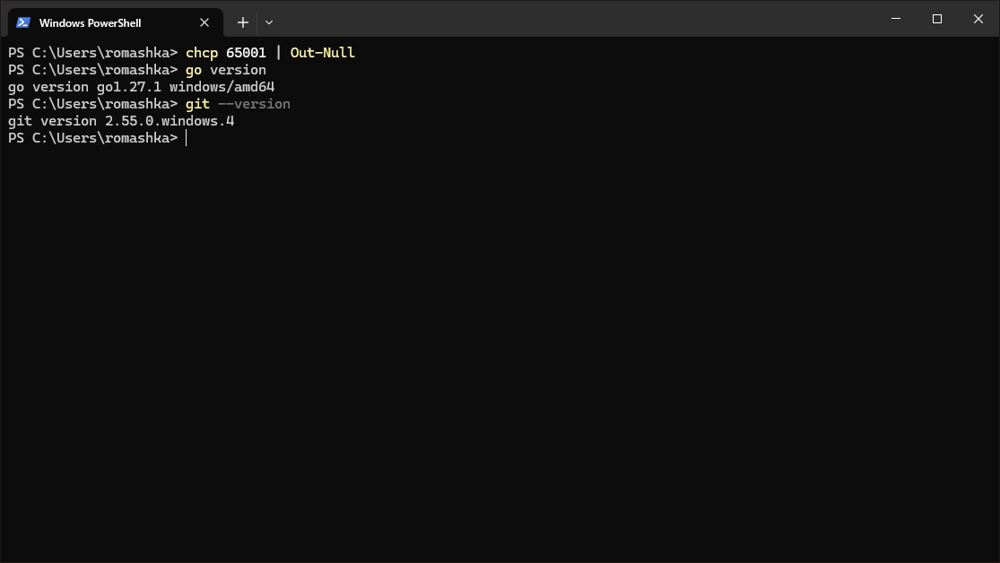
## Структура проекта и инициализация модуля

Выбираю папку для проекта, создаю её и инициализирую Go-модуль:

```
mkdir helloapi
cd helloapi
go mod init example.com/helloapi
```

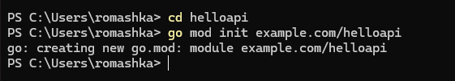

Теперь создаю папку для серверной части:

```
mkdir cmd\server
```
## Минимальный HTTP-сервер (первая версия)

Создаю файл `cmd\server\main.go` и добавляю туда код сервера:

```go
package main

import (
	"encoding/json"
	"fmt"
	"log"
	"net/http"
)

type user struct {
	ID   string `json:"id"`
	Name string `json:"name"`
}

func main() {
	mux := http.NewServeMux()

	// Текстовый ответ
	mux.HandleFunc("/hello", func(w http.ResponseWriter, r *http.Request) {
		fmt.Fprintf(w, "Hello, world!")
	})

	// Пока временный JSON (без UUID — добавим на шаге 4)
	mux.HandleFunc("/user", func(w http.ResponseWriter, r *http.Request) {
		w.Header().Set("Content-Type", "application/json")
		_ = json.NewEncoder(w).Encode(user{
			ID:   "temp",
			Name: "Gopher",
		})
	})

	addr := ":8080"
	log.Printf("Starting on %s ...", addr)
	log.Fatal(http.ListenAndServe(addr, mux))
}
```

## Ставим зависимость и дорабатываем `/user`

Кстати, пока у пользователя временный ID. Чтобы генерировать нормальный UUID, подключаю библиотеку `google/uuid`:

```
go get github.com/google/uuid@latest
go mod tidy
```

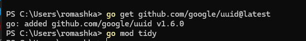

Теперь правлю `cmd\server\main.go`: добавляю импорт `github.com/google/uuid` и заменяю `"temp"` на UUID, который генерируется при каждом запросе:

```go
mux.HandleFunc("/user", func(w http.ResponseWriter, r *http.Request) {
	w.Header().Set("Content-Type", "application/json")
	_ = json.NewEncoder(w).Encode(user{
		ID:   uuid.NewString(), // теперь реальный UUID
		Name: "Gopher",
	})
})
```

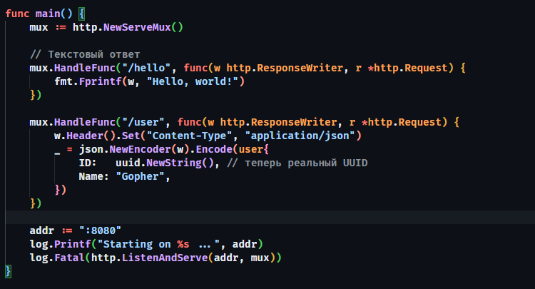
## Запуск сервера и проверка

Запускаю приложение из корня проекта:

```
go run ./cmd/server
```

Вот что получилось у меня:

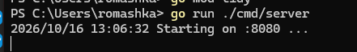

Проверяю, что оба маршрута отвечают:

```powershell
Invoke-WebRequest http://localhost:8080/hello
Invoke-WebRequest http://localhost:8080/user
```

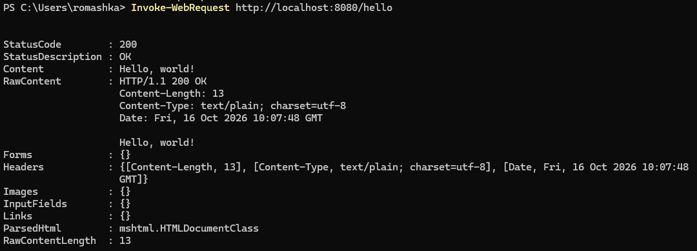 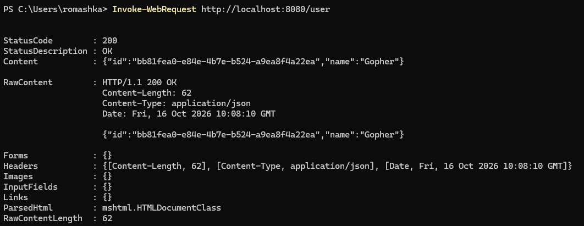

## Собираю бинарник и проверяю ещё раз

Теперь собираю проект в отдельный исполняемый файл:

```
go build -o helloapi.exe ./cmd/server
```

Запускаю уже собранный бинарник:

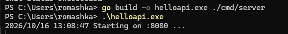

Повторно проверяю эндпоинты:

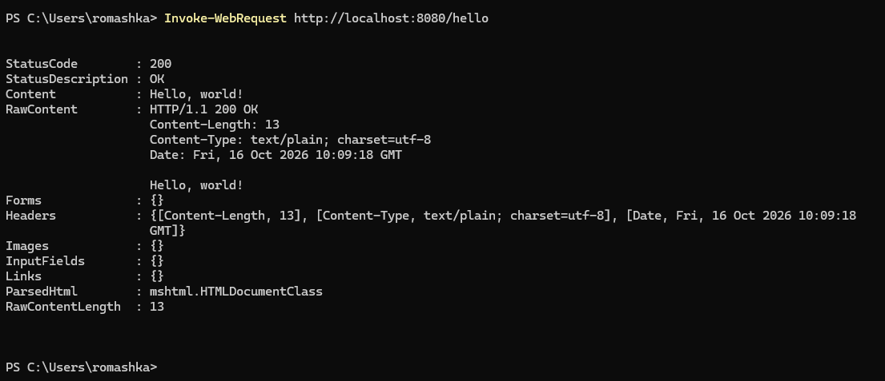 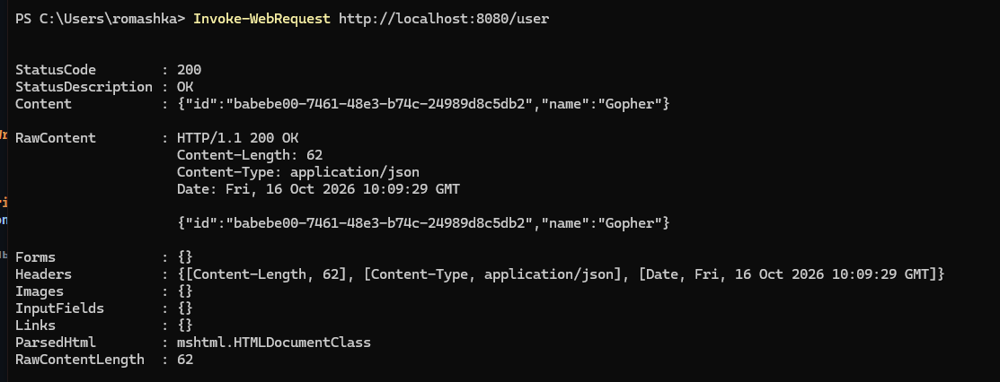
## Линтер и базовые проверки

Перед тем как двигаться дальше, форматирую код и запускаю встроенную проверку:

```
go fmt ./...
go vet ./...
```

Если всё прошло нормально, ошибок и предупреждений от `go vet` быть не должно.

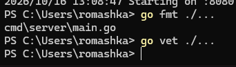
## \[Доп.] Задание: конфигурация через ENV и сигнал сервера

Теперь немного расширяю сервер. Хочу, чтобы порт можно было менять через `APP_PORT`, а ещё добавляю `/health`, который возвращает статус и время в формате RFC3339. Заодно добавлю простое логирование запросов.

```go
package main

import (
	"encoding/json"
	"fmt"
	"log"
	"net/http"
	"os"
	"time"

	"github.com/google/uuid"
)

type user struct {
	ID   string `json:"id"`
	Name string `json:"name"`
}

type health struct {
	Status string `json:"status"`
	Time   string `json:"time"`
}

func main() {
	port := os.Getenv("APP_PORT")
	if port == "" {
		port = "8080"
	}

	mux := http.NewServeMux()

	mux.HandleFunc("/hello", func(w http.ResponseWriter, r *http.Request) {
		log.Printf("%s %s", r.Method, r.URL.Path)
		fmt.Fprintf(w, "Hello, world!")
	})

	mux.HandleFunc("/user", func(w http.ResponseWriter, r *http.Request) {
		log.Printf("%s %s", r.Method, r.URL.Path)
		w.Header().Set("Content-Type", "application/json")
		_ = json.NewEncoder(w).Encode(user{
			ID:   uuid.NewString(),
			Name: "Gopher",
		})
	})

	mux.HandleFunc("/health", func(w http.ResponseWriter, r *http.Request) {
		log.Printf("%s %s", r.Method, r.URL.Path)
		w.Header().Set("Content-Type", "application/json")
		_ = json.NewEncoder(w).Encode(health{
			Status: "ok",
			Time:   time.Now().Format(time.RFC3339),
		})
	})

	addr := ":" + port
	log.Printf("Starting on %s ...", addr)
	log.Fatal(http.ListenAndServe(addr, mux))
}
```

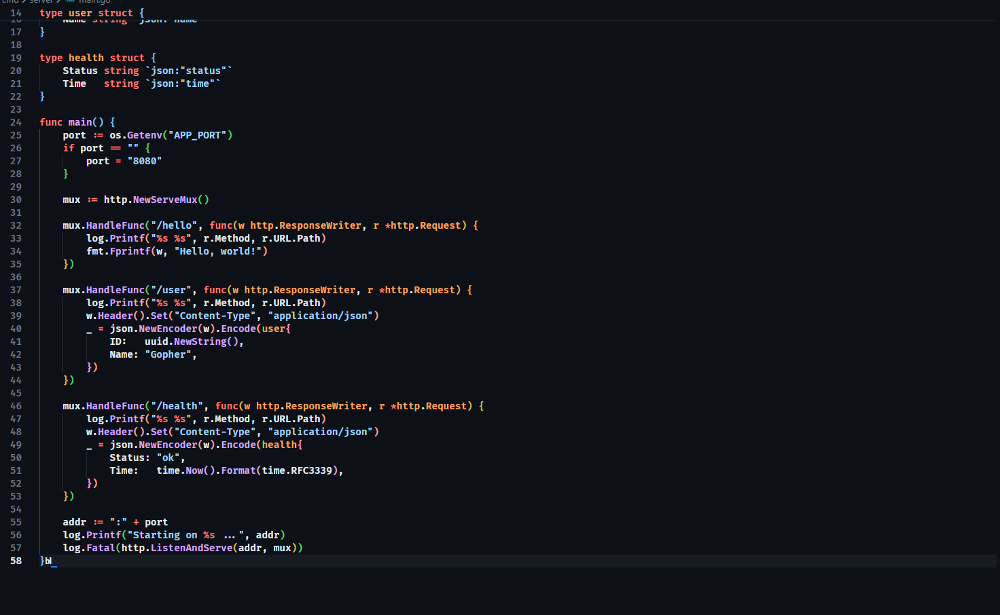

Проверяю запуск на другом порту. Главное не забыть, что переменная окружения задаётся в той же сессии PowerShell:

```powershell
$env:APP_PORT="8081"
go run ./cmd/server
Invoke-WebRequest http://localhost:8081/health
```

Вот что получилось:

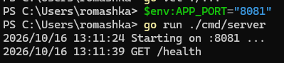
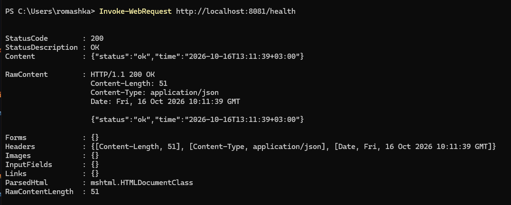

## Защита (ответы на вопросы)

1. Что такое Go-модуль? Для чего нужны `go.mod` и `go.sum`?

- Модуль — это набор Go-пакетов, у которого есть свой путь импорта и файл `go.mod`.
- `go.mod` хранит имя модуля, версию Go и список зависимостей.
- `go.sum` содержит контрольные суммы зависимостей. По ним Go проверяет, что скачанный код соответствует ожидаемому.

2. Чем отличаются `go run` и `go build`?

- `go run ./cmd/server` — компилирует и сразу запускает приложение.
- `go build -o helloapi.exe ./cmd/server` — собирает отдельный исполняемый файл. Его потом можно запускать без команды `go run`.

3. Как сервер возвращает JSON и зачем нужен `Content-Type`?

В обработчике сначала выставляю заголовок `Content-Type: application/json`, а затем передаю структуру в `json.NewEncoder(w).Encode(v)`. Go сам преобразует структуру в JSON и записывает её в ответ. Заголовок подсказывает клиенту, что именно он получил, — JSON, а не обычный текст или HTML.

4. Как подключить библиотеку и привести зависимости в порядок?

- `go get github.com/google/uuid@latest` — скачивает библиотеку и добавляет её в зависимости проекта.
- `go mod tidy` — проверяет зависимости: убирает неиспользуемые и добавляет те, которых не хватает.
- После этого импортируется пакет через `import "github.com/google/uuid"` и используется `uuid.NewString()` для генерации ID.

5. Как прочитать переменную окружения и задать порт?

Используется `os.Getenv("APP_PORT")`. Она возвращает значение переменной окружения или пустую строку, если её нет.

Если порт не задан, оставляем стандартный `8080`:

```go
port := os.Getenv("APP_PORT")
if port == "" {
	port = "8080"
}
addr := ":" + port
```

Например в PowerShell порт можно задать так:

```powershell
$env:APP_PORT="8081"
go run ./cmd/server
```