|        |              |
| :----: | :----------- |
|  Имя   | Акулов Роман |
| Группа | ЭФМО-01-26   |
# Практическая работа № 2. Структура Go-проекта и HTTP-сервер

## Предварительная подготовка

1. Проверим, что Go и Git установлены и доступны из терминала.

```powershell
go version
git --version
```

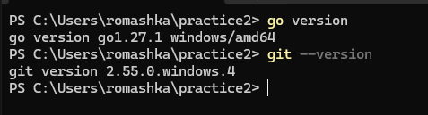
## Создание скелета проекта

1. Создадим папку проекта, перейдем в нее и инициализируем Git-репозиторий вместе с Go-модулем.

```
mkdir -p myapp
cd myapp

git init
go mod init github.com/FlewToL/myapp
```

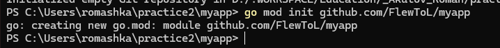

2. Добавим `.gitignore`, чтобы не отправлять в репозиторий собранные бинарники, логи и другие временные файлы.

```
/bin/
/dist/
/coverage.out
*.log
```

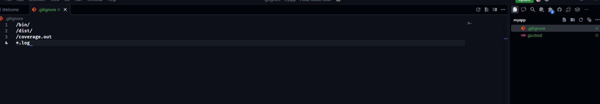

> [!tip]  
> При создании репозитория на GitHub можно сразу выбрать шаблон `.gitignore` для Go. Здесь мы используем его вручную, чтобы понимать, какие файлы исключаем.

3. Подготовим каталоги и файлы приложения.

```bash
mkdir -p cmd/myapp internal/app utils

# Создаем основные файлы проекта
touch cmd/myapp/main.go
touch internal/app/app.go
touch utils/logger.go
```

Структура получится следующей:

```
myapp/
├── cmd/
│   └── myapp/
│       └── main.go
├── internal/
│   └── app/
│       └── app.go
├── utils/
│   └── logger.go
├── .gitignore
└── go.mod
```

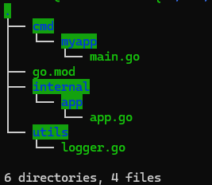
## Создание кода для скелета проекта

1. В `cmd/myapp/main.go` оставим точку входа. Отсюда будем запускать основную логику приложения.

```go
package main

import "github.com/FlewToL/myapp/internal/app"

func main() {
	app.Run()
}
```

2. В `internal/app/app.go` настроим HTTP-сервер с двумя маршрутами: `/` для обычного текста и `/ping` для JSON-ответа.

```go
package app

import (
	"encoding/json"
	"fmt"
	"net/http"
	"time"

	"github.com/FlewToL/myapp/utils"
)

type pingResp struct {
	Status string `json:"status"`
	Time   string `json:"time"`
}

func Run() {
	mux := http.NewServeMux()

	// Главная страница
	mux.HandleFunc("/", func(w http.ResponseWriter, r *http.Request) {
		utils.LogRequest(r)

		w.Header().Set("Content-Type", "text/plain; charset=utf-8")
		fmt.Fprintf(w, "Hello, Go project structure!")
	})

	// Проверка доступности сервера
	mux.HandleFunc("/ping", func(w http.ResponseWriter, r *http.Request) {
		utils.LogRequest(r)

		w.Header().Set("Content-Type", "application/json; charset=utf-8")
		_ = json.NewEncoder(w).Encode(pingResp{
			Status: "ok",
			Time:   time.Now().UTC().Format(time.RFC3339),
		})
	})

	utils.LogInfo("Server is starting on :8080")

	if err := http.ListenAndServe(":8080", mux); err != nil {
		utils.LogError("server error: " + err.Error())
	}
}
```

3. В `utils/logger.go` вынесем логирование запросов, обычных сообщений и ошибок. Так не придется повторять формат вывода в разных частях приложения.

```go
package utils

import (
	"fmt"
	"net/http"
	"time"
)

// Записываем основные данные HTTP-запроса
func LogRequest(r *http.Request) {
	fmt.Printf("[%s] %s %s %s\n",
		time.Now().Format(time.RFC3339),
		r.RemoteAddr,
		r.Method,
		r.URL.Path,
	)
}

func LogInfo(msg string) {
	fmt.Printf("[INFO] %s %s\n",
		time.Now().Format(time.RFC3339),
		msg,
	)
}

func LogError(msg string) {
	fmt.Printf("[ERROR] %s %s\n",
		time.Now().Format(time.RFC3339),
		msg,
	)
}
```
## Запуск и быстрая проверка

1. Запустим приложение из корня проекта.

```powershell
go run ./cmd/myapp
```

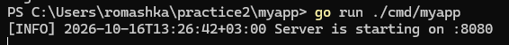

2. Проверим оба маршрута через HTTP-запросы.

```powershell
Invoke-WebRequest http://localhost:8080/
Invoke-WebRequest http://localhost:8080/ping
```

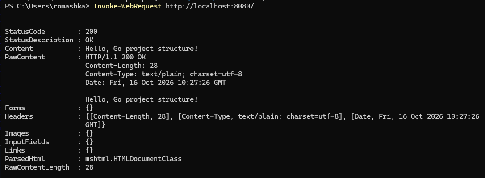
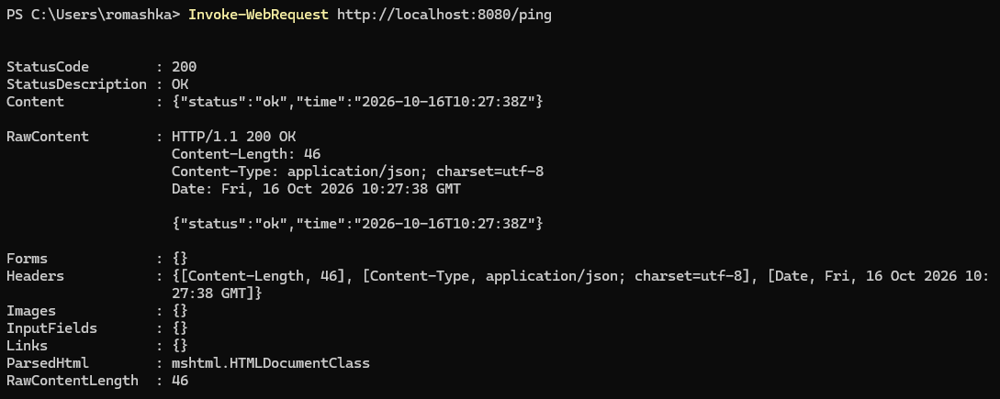

3. Соберем приложение в бинарник и запустим уже его, а не исходный код.

```
go build -o bin/myapp.exe ./cmd/myapp
./bin/myapp.exe
```

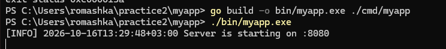
## Дополнительные задания

### (\*) <ЗАДАНИЕ A: Добавить Request-ID и улучшить логи>

1. В `utils/logger.go` добавим генератор идентификатора запроса. Он будет возвращать 16 символов в шестнадцатеричном формате.

В существующий блок `import` добавим новые пакеты:

```go
import (
	"crypto/rand"
	"encoding/hex"
	"fmt"
	"net/http"
	"time"
)
```

Реализуем генератор:

```go
// Генерируем случайный ID из 8 байт
func NewID16() string {
	b := make([]byte, 8)
	_, _ = rand.Read(b)

	return hex.EncodeToString(b)
}
```

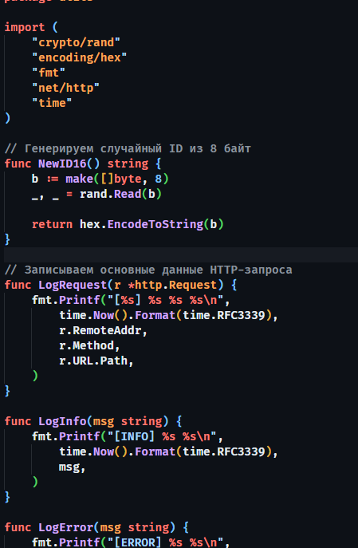

2. В `internal/app/app.go` добавим middleware `withRequestID`. Если клиент передал `X-Request-Id`, используем его. Если заголовка нет, создадим ID самостоятельно.

```go
func withRequestID(next http.Handler) http.Handler {
	return http.HandlerFunc(func(w http.ResponseWriter, r *http.Request) {
		id := r.Header.Get("X-Request-Id")

		if id == "" {
			id = utils.NewID16()
		}

		w.Header().Set("X-Request-Id", id)
		next.ServeHTTP(w, r)
	})
}
```

3. Подключим middleware при запуске сервера. Вместо `mux` передадим в `ListenAndServe` обработчик с Request-ID.

```go
// Оборачиваем маршруты в middleware
handler := withRequestID(mux)

utils.LogInfo("Server is starting on :8080")

if err := http.ListenAndServe(":8080", handler); err != nil {
	utils.LogError("server error: " + err.Error())
}
```

4. Проверим запросы с автоматическим и собственным идентификатором.

```powershell
Invoke-WebRequest http://localhost:8080/ping
Invoke-WebRequest -H "X-Request-Id: demo-123" http://localhost:8080/ping
```

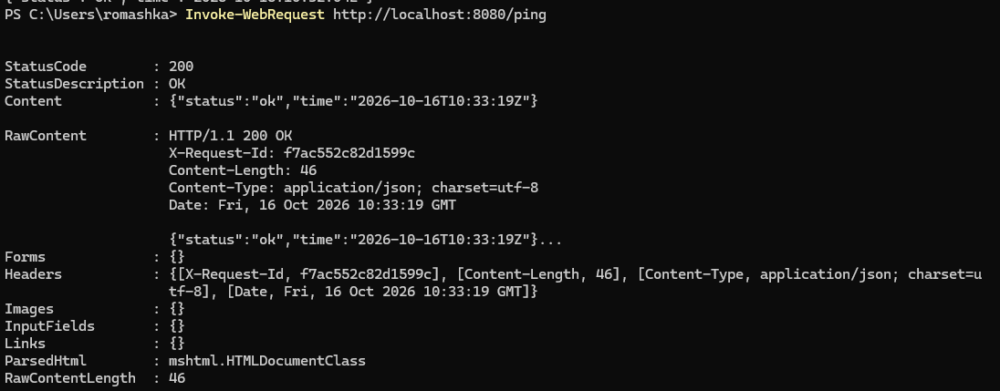
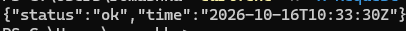
### (\*) <ЗАДАНИЕ B: Сделать единый формат JSON-ошибок>

1. Создадим `utils/httpjson.go`. Здесь будем хранить структуру JSON-ошибки и функции для отправки JSON-ответов.

```go
package utils

import (
	"encoding/json"
	"net/http"
)

type JSONError struct {
	Error string `json:"error"`
}

// Отправляем JSON с нужным HTTP-кодом
func WriteJSON(w http.ResponseWriter, code int, v any) {
	w.Header().Set("Content-Type", "application/json; charset=utf-8")
	w.WriteHeader(code)

	_ = json.NewEncoder(w).Encode(v)
}

func WriteErr(w http.ResponseWriter, code int, msg string) {
	WriteJSON(w, code, JSONError{Error: msg})
}
```

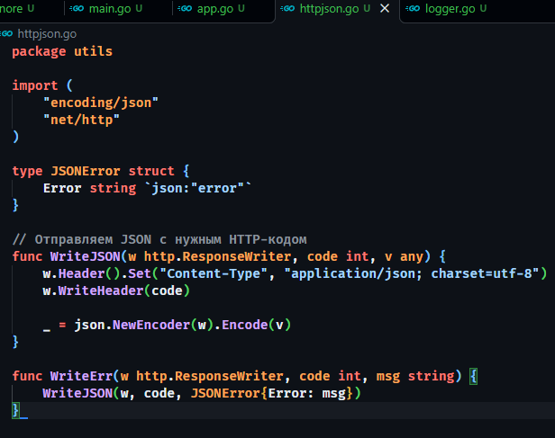

2. В `internal/app/app.go` добавим маршрут `/fail`, который вернет ошибку в JSON-формате.

```go
mux.HandleFunc("/fail", func(w http.ResponseWriter, r *http.Request) {
	utils.LogRequest(r)

	utils.WriteErr(w, http.StatusBadRequest, "bad_request_example")
})
```

3. Проверим, что сервер возвращает ошибку с кодом `400 Bad Request` и JSON-телом.

```powershell
Invoke-WebRequest http://localhost:8080/fail
```

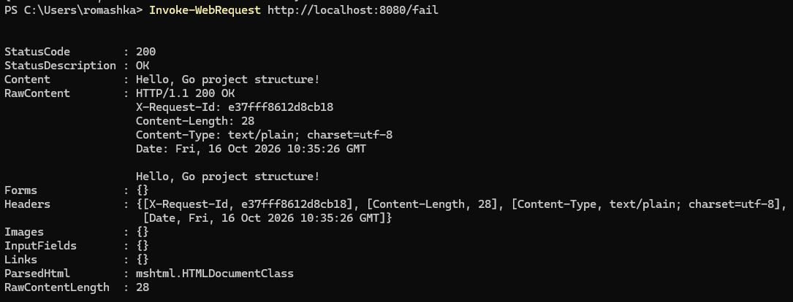
### (\*) <ЗАДАНИЕ C: Разделить HTTP-обработчики>

1. Создадим отдельный пакет для обработчиков. Перенесем туда `/ping`, чтобы `app.go` отвечал за маршруты, а код обработки запроса хранился отдельно.

```
mkdir internal/app/handlers
touch internal/app/handlers/ping.go
```

2. В `internal/app/handlers/ping.go` перенесем обработчик `/ping`.

```go
package handlers

import (
	"encoding/json"
	"net/http"
	"time"

	"github.com/FlewToL/myapp/utils"
)

type pingResp struct {
	Status string `json:"status"`
	Time   string `json:"time"`
}

func Ping(w http.ResponseWriter, r *http.Request) {
	utils.LogRequest(r)

	w.Header().Set("Content-Type", "application/json; charset=utf-8")

	_ = json.NewEncoder(w).Encode(pingResp{
		Status: "ok",
		Time:   time.Now().UTC().Format(time.RFC3339),
	})
}
```

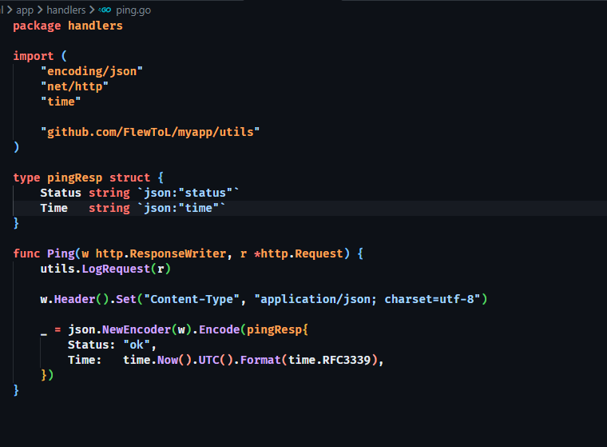

3. В `internal/app/app.go` добавим импорт нового пакета и заменим анонимную функцию на `handlers.Ping`.

```
import (
	// Остальные импорты приложения
	"github.com/FlewToL/myapp/internal/app/handlers"
)
```

Внутри `Run()`:

```
mux.HandleFunc("/ping", handlers.Ping)
```

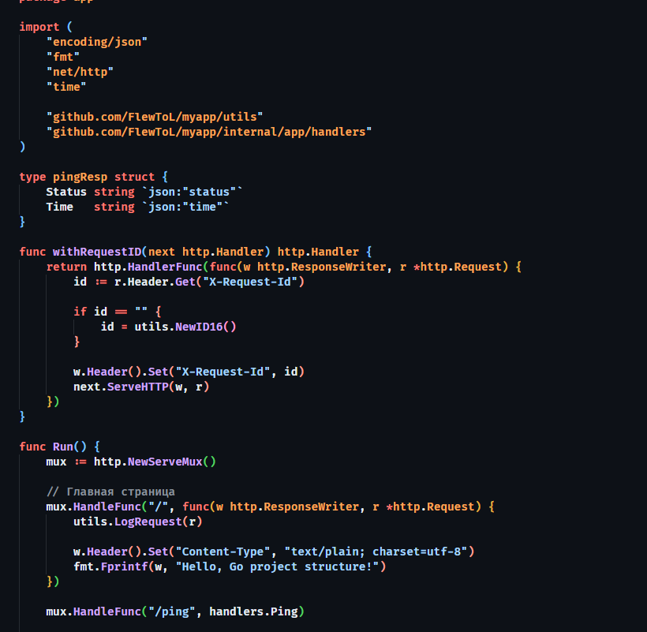

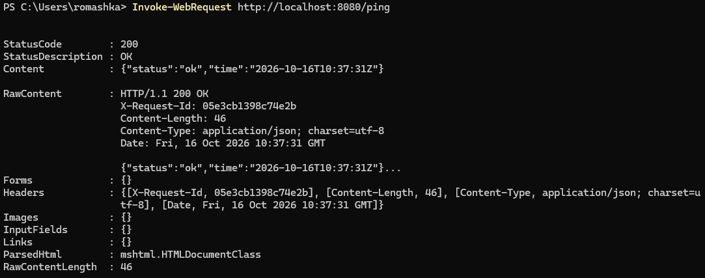
## Работа с репозиторием

1. Зафиксируем изменения в Git. В моем случае отправим практическую работу в существующую ветку репозитория, поэтому сначала проверим текущую ветку.

```
git branch
git status
```

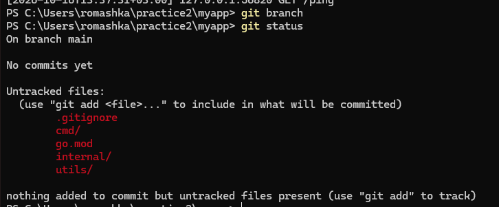

2. Добавим файлы в индекс, создадим коммит и отправим его на GitHub.

```
git add .
git commit -m "Add practice 02 to the workspace"
git push
```

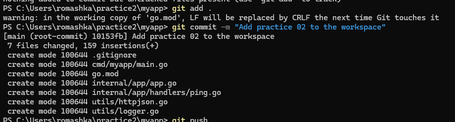

> [!warning]  
> Если работаем в новой ветке, перед отправкой нужно переключиться на нее и при первом push указать upstream. Команда `git checkout` без имени ветки не переключает нас на нужную ветку.

Эссе и документация проекта находятся в начале файла на репозитории.
## Ответы на вопросы

**1. Чем** `**internal/**` **отличается от** `**pkg/**`**?**

- `internal/` — закрытый код приложения. Go не разрешает импортировать его из посторонних модулей.
- `pkg/` часто используют для библиотек, которые хотят сделать доступными другим проектам.
- Для логики нашего сервера подходит `internal/`, потому что мы не собираемся публиковать ее как отдельную библиотеку.

**2. Почему не стоит создавать слишком много пакетов?**

- Сложнее ориентироваться в проекте.
- Можно получить циклические импорты: пакет A импортирует B, а B импортирует A.
- Начнем с простой структуры и будем выделять пакеты, когда появится реальная причина.

**3. Зачем хранить API-контракты в** `**api/**`**?**

- Контракт описывает, как сервисы общаются друг с другом.
- Например, OpenAPI или protobuf можно использовать для генерации клиентов и документации.
- Так мы отделяем описание API от реализации HTTP-обработчиков.

**4. Почему** `**src/**` **в корне Go-модуля обычно не нужен?**

- В старом подходе GOPATH исходники хранились в `$GOPATH/src`.
- В Go Modules корень проекта уже обозначает модуль.
- Поэтому в нашем проекте используем `cmd/`, `internal/` и `utils/`, а не добавляем лишний уровень `src/`.