|        |              |
| :----: | :----------- |
|  Имя   | Акулов Роман |
| Группа | ЭФМО-01-26   |
## 1. Создание структуры проекта и инициализация модуля

Подготовим каталог проекта, создадим папки для серверной части, API и хранилища, после чего инициализируем модуль Go:

```bash
mkdir pz3-http
cd pz3-http
mkdir -pv cmd/server internal/api internal/storage
go mod init example.com/pz3-http
```

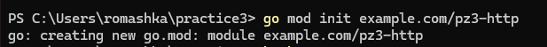
## 2. Создание проекта и его кода

Сначала реализуем хранилище задач в `internal/storage/memory.go`. Оно будет держать задачи в памяти, а для безопасного доступа из нескольких обработчиков используем `sync.RWMutex`.

```go
package storage

import (
	"errors"
	"sync"
)

var ErrNotFound = errors.New("not found")

type Task struct {
	ID    int64  `json:"id"`
	Title string `json:"title"`
	Done  bool   `json:"done"`
}

type MemoryStore struct {
	mu    sync.RWMutex
	auto  int64
	tasks map[int64]*Task
}

func NewMemoryStore() *MemoryStore {
	return &MemoryStore{
		tasks: make(map[int64]*Task),
	}
}

func (s *MemoryStore) Create(title string) *Task {
	s.mu.Lock()
	defer s.mu.Unlock()

	s.auto++
	t := &Task{ID: s.auto, Title: title, Done: false}
	s.tasks[t.ID] = t

	cp := *t
	return &cp
}

func (s *MemoryStore) Get(id int64) (*Task, error) {
	s.mu.RLock()
	defer s.mu.RUnlock()

	t, ok := s.tasks[id]
	if !ok {
		return nil, ErrNotFound
	}

	cp := *t
	return &cp, nil
}

func (s *MemoryStore) List() []*Task {
	s.mu.RLock()
	defer s.mu.RUnlock()

	out := make([]*Task, 0, len(s.tasks))
	for _, t := range s.tasks {
		cp := *t
		out = append(out, &cp)
	}
	return out
}

func (s *MemoryStore) UpdateDone(id int64, done bool) (*Task, error) {
	s.mu.Lock()
	defer s.mu.Unlock()

	t, ok := s.tasks[id]
	if !ok {
		return nil, ErrNotFound
	}

	t.Done = done
	cp := *t
	return &cp, nil
}

func (s *MemoryStore) Delete(id int64) error {
	s.mu.Lock()
	defer s.mu.Unlock()

	if _, ok := s.tasks[id]; !ok {
		return ErrNotFound
	}

	delete(s.tasks, id)
	return nil
}
```

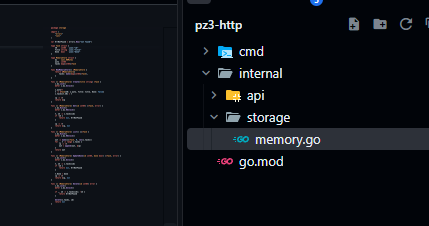

Чтобы не дублировать формирование ответов в обработчиках, вынесем общие функции для JSON и HTTP-ошибок в `internal/api/responses.go`.

```go
package api

import (
	"encoding/json"
	"net/http"
)

type ErrorResponse struct {
	Error string `json:"error"`
}

func JSON(w http.ResponseWriter, status int, v any) {
	w.Header().Set("Content-Type", "application/json")
	w.WriteHeader(status)

	if v != nil {
		_ = json.NewEncoder(w).Encode(v)
	}
}

func BadRequest(w http.ResponseWriter, msg string) {
	JSON(w, http.StatusBadRequest, ErrorResponse{Error: msg})
}

func NotFound(w http.ResponseWriter, msg string) {
	JSON(w, http.StatusNotFound, ErrorResponse{Error: msg})
}

func UnprocessableEntity(w http.ResponseWriter, msg string) {
	JSON(w, http.StatusUnprocessableEntity, ErrorResponse{Error: msg})
}

func Internal(w http.ResponseWriter, msg string) {
	JSON(w, http.StatusInternalServerError, ErrorResponse{Error: msg})
}

func MethodNotAllowed(w http.ResponseWriter, msg string) {
	JSON(w, http.StatusMethodNotAllowed, ErrorResponse{Error: msg})
}
```

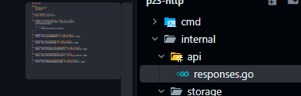

Далее добавим обработчики в `internal/api/handlers.go`. Они будут разбирать входные данные, проверять их и обращаться к хранилищу.

```go
package api

import (
	"encoding/json"
	"errors"
	"net/http"
	"strconv"
	"strings"

	"example.com/pz3-http/internal/storage"
)

type Handlers struct {
	Store *storage.MemoryStore
}

func NewHandlers(store *storage.MemoryStore) *Handlers {
	return &Handlers{Store: store}
}

type createTaskRequest struct {
	Title string `json:"title"`
}

type patchTaskRequest struct {
	Done *bool `json:"done"`
}

// GET /tasks?q=text
func (h *Handlers) ListTasks(w http.ResponseWriter, r *http.Request) {
	tasks := h.Store.List()

	q := strings.TrimSpace(r.URL.Query().Get("q"))
	if q != "" {
		filtered := make([]*storage.Task, 0)
		lowerQ := strings.ToLower(q)

		for _, t := range tasks {
			if strings.Contains(strings.ToLower(t.Title), lowerQ) {
				filtered = append(filtered, t)
			}
		}

		tasks = filtered
	}

	JSON(w, http.StatusOK, tasks)
}

// POST /tasks
func (h *Handlers) CreateTask(w http.ResponseWriter, r *http.Request) {
	if ct := r.Header.Get("Content-Type"); ct != "" && !strings.Contains(ct, "application/json") {
		BadRequest(w, "Content-Type must be application/json")
		return
	}

	var req createTaskRequest
	if err := json.NewDecoder(r.Body).Decode(&req); err != nil {
		BadRequest(w, "invalid JSON body")
		return
	}

	title := strings.TrimSpace(req.Title)
	if len([]rune(title)) < 3 || len([]rune(title)) > 140 {
		UnprocessableEntity(w, "title must be 3..140 characters")
		return
	}

	task := h.Store.Create(title)
	JSON(w, http.StatusCreated, task)
}

// GET /tasks/{id}
func (h *Handlers) GetTask(w http.ResponseWriter, r *http.Request) {
	id, ok := parseIDFromPath(w, r)
	if !ok {
		return
	}

	task, err := h.Store.Get(id)
	if err != nil {
		if errors.Is(err, storage.ErrNotFound) {
			NotFound(w, "task not found")
			return
		}
		Internal(w, "unexpected error")
		return
	}

	JSON(w, http.StatusOK, task)
}

// PATCH /tasks/{id}
func (h *Handlers) PatchTask(w http.ResponseWriter, r *http.Request) {
	id, ok := parseIDFromPath(w, r)
	if !ok {
		return
	}

	var req patchTaskRequest
	if err := json.NewDecoder(r.Body).Decode(&req); err != nil {
		BadRequest(w, "invalid JSON body")
		return
	}

	if req.Done == nil {
		BadRequest(w, "field done is required")
		return
	}

	task, err := h.Store.UpdateDone(id, *req.Done)
	if err != nil {
		if errors.Is(err, storage.ErrNotFound) {
			NotFound(w, "task not found")
			return
		}
		Internal(w, "unexpected error")
		return
	}

	JSON(w, http.StatusOK, task)
}

// DELETE /tasks/{id}
func (h *Handlers) DeleteTask(w http.ResponseWriter, r *http.Request) {
	id, ok := parseIDFromPath(w, r)
	if !ok {
		return
	}

	if err := h.Store.Delete(id); err != nil {
		if errors.Is(err, storage.ErrNotFound) {
			NotFound(w, "task not found")
			return
		}
		Internal(w, "unexpected error")
		return
	}

	w.WriteHeader(http.StatusNoContent)
}

func parseIDFromPath(w http.ResponseWriter, r *http.Request) (int64, bool) {
	path := strings.Trim(r.URL.Path, "/")
	parts := strings.Split(path, "/")

	if len(parts) != 2 || parts[0] != "tasks" {
		NotFound(w, "invalid path")
		return 0, false
	}

	id, err := strconv.ParseInt(parts[1], 10, 64)
	if err != nil {
		BadRequest(w, "invalid id")
		return 0, false
	}

	return id, true
}
```

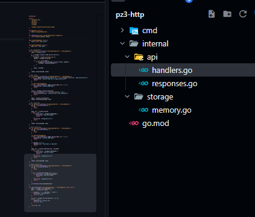

Для запросов подключим middleware из `internal/api/middleware.go`: логирование сохранит метод, путь, статус и длительность запроса, а CORS позволит обращаться к API из браузерного клиента.

```go
package api

import (
	"log"
	"net/http"
	"time"
)

type statusRecorder struct {
	http.ResponseWriter
	status int
}

func (r *statusRecorder) WriteHeader(code int) {
	r.status = code
	r.ResponseWriter.WriteHeader(code)
}

func (r *statusRecorder) Write(b []byte) (int, error) {
	if r.status == 0 {
		r.status = http.StatusOK
	}
	return r.ResponseWriter.Write(b)
}

func Logging(next http.Handler) http.Handler {
	return http.HandlerFunc(func(w http.ResponseWriter, r *http.Request) {
		start := time.Now()
		rec := &statusRecorder{ResponseWriter: w, status: http.StatusOK}

		next.ServeHTTP(rec, r)

		log.Printf("%s %s %d %s", r.Method, r.URL.Path, rec.status, time.Since(start))
	})
}

func CORS(next http.Handler) http.Handler {
	return http.HandlerFunc(func(w http.ResponseWriter, r *http.Request) {
		w.Header().Set("Access-Control-Allow-Origin", "*")
		w.Header().Set("Access-Control-Allow-Methods", "GET, POST, PATCH, DELETE, OPTIONS")
		w.Header().Set("Access-Control-Allow-Headers", "Content-Type, Authorization")

		if r.Method == http.MethodOptions {
			w.WriteHeader(http.StatusNoContent)
			return
		}

		next.ServeHTTP(w, r)
	})
}
```

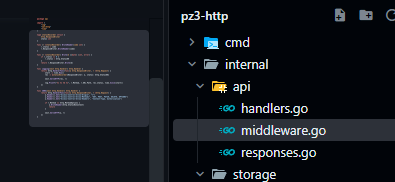

В `cmd/server/main.go` соберём маршруты и подключим созданные обработчики и middleware. Также настроим завершение сервера по сигналу, чтобы он мог корректно остановиться:

```go
package main

import (
	"context"
	"errors"
	"log"
	"net/http"
	"os"
	"os/signal"
	"syscall"
	"time"

	"example.com/pz3-http/internal/api"
	"example.com/pz3-http/internal/storage"
)

func main() {
	store := storage.NewMemoryStore()
	h := api.NewHandlers(store)

	mux := http.NewServeMux()

	mux.HandleFunc("/health", func(w http.ResponseWriter, r *http.Request) {
		if r.Method != http.MethodGet {
			api.MethodNotAllowed(w, "method not allowed")
			return
		}
		api.JSON(w, http.StatusOK, map[string]string{"status": "ok"})
	})

	mux.HandleFunc("/tasks", func(w http.ResponseWriter, r *http.Request) {
		switch r.Method {
		case http.MethodGet:
			h.ListTasks(w, r)
		case http.MethodPost:
			h.CreateTask(w, r)
		default:
			api.MethodNotAllowed(w, "method not allowed")
		}
	})

	mux.HandleFunc("/tasks/", func(w http.ResponseWriter, r *http.Request) {
		switch r.Method {
		case http.MethodGet:
			h.GetTask(w, r)
		case http.MethodPatch:
			h.PatchTask(w, r)
		case http.MethodDelete:
			h.DeleteTask(w, r)
		default:
			api.MethodNotAllowed(w, "method not allowed")
		}
	})

	handler := api.Logging(api.CORS(mux))

	addr := ":8080"
	if port := os.Getenv("PORT"); port != "" {
		addr = ":" + port
	}

	srv := &http.Server{
		Addr:    addr,
		Handler: handler,
	}

	go func() {
		log.Println("listening on", addr)
		if err := srv.ListenAndServe(); err != nil && !errors.Is(err, http.ErrServerClosed) {
			log.Fatalf("server error: %v", err)
		}
	}()

	quit := make(chan os.Signal, 1)
	signal.Notify(quit, syscall.SIGINT, syscall.SIGTERM)
	<-quit

	log.Println("shutting down...")

	ctx, cancel := context.WithTimeout(context.Background(), 5*time.Second)
	defer cancel()

	if err := srv.Shutdown(ctx); err != nil {
		log.Fatal("server forced to shutdown:", err)
	}

	log.Println("server stopped")
}
```

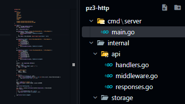
## 3. Запуск сервера

Запустим сервер локально командой:

```powershell
go run ./cmd/server
```

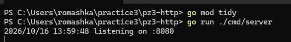
## 4. Тестирование

Сначала проверим служебный маршрут `GET /health`, который должен вернуть статус сервера:

```powershell
Invoke-WebRequest http://localhost:8080/health
```

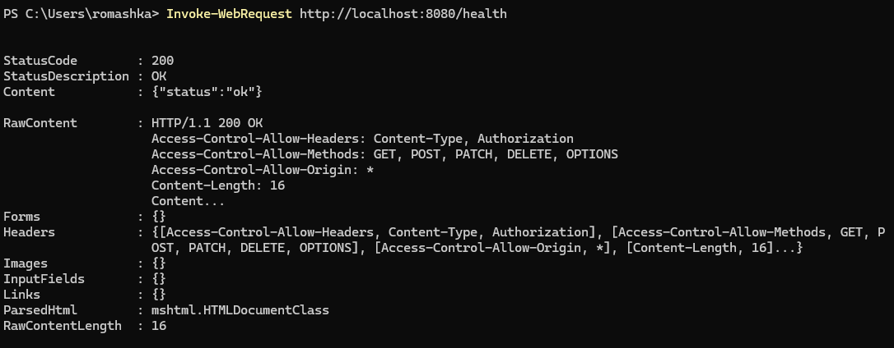

Проверим создание задачи через `POST /tasks`. В теле запроса передадим название задачи в JSON:

```powershell
Invoke-RestMethod -Method Post -Uri http://localhost:8080/tasks -ContentType "application/json" -Body '{"title":"Сбежать от семьи за молоком"}'
```

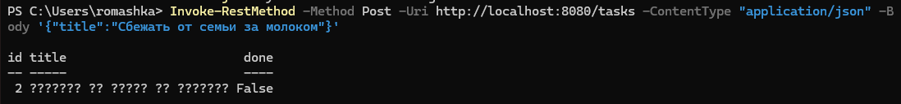

Затем запросим список созданных задач методом `GET /tasks`:

```powershell
Invoke-RestMethod http://localhost:8080/tasks
```

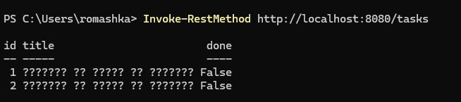

>[!Warning]
>При правильной кодировке, Powershell корректо считывает данные в базу, но неправильно их выводит. Это можно проверить если открыть API в браузере:
>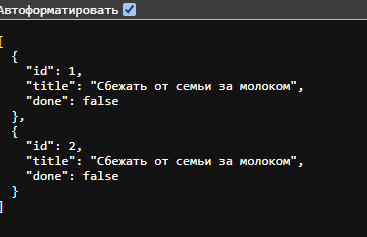
>
>Дальше лучше используем английские символы, чтобы избегать путаницы.

Проверим фильтрацию списка по части названия с помощью параметра `q`:

```powershell
Invoke-RestMethod "http://localhost:8080/tasks?q=Buy"
```

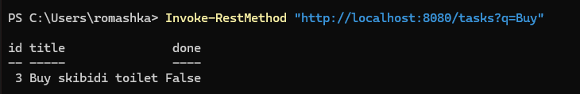

Получим отдельную задачу по её идентификатору:

```powershell
Invoke-RestMethod http://localhost:8080/tasks/1
```

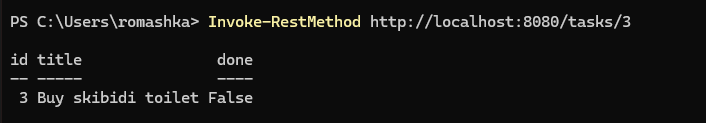

Обновим поле `done` у задачи методом `PATCH`. Так отметим её как выполненную:

```powershell
Invoke-RestMethod -Method Patch -Uri http://localhost:8080/tasks/1 -ContentType "application/json" -Body '{"done":true}'
```

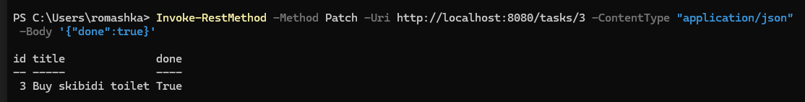

В конце проверим удаление задачи методом `DELETE`:

```powershell
Invoke-RestMethod -Method Delete -Uri http://localhost:8080/tasks/1
```

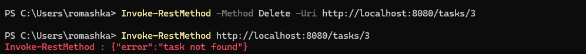

*Ответ не содержит тела: для успешного удаления сервер возвращает статус `204 No Content`.*

> [!tip] Почему используем `Invoke-RestMethod`
> Мы работаем в PowerShell, поэтому для отправки JSON удобнее использовать `Invoke-RestMethod`. Так запрос остаётся компактным и не приходится собирать многострочную команду `curl`.

Отдельно отправим некорректные запросы и посмотрим, какие коды и сообщения об ошибках возвращает сервер:

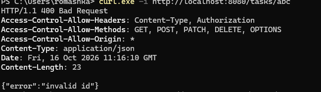
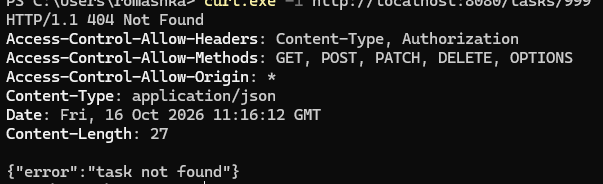
### 4.1. Юнит-тесты

Добавим тесты обработчиков в `internal/api/handlers_test.go`. Проверим создание задачи, валидацию названия и фильтрацию списка:

```go
package api

import (
	"bytes"
	"encoding/json"
	"net/http"
	"net/http/httptest"
	"testing"

	"example.com/pz3-http/internal/storage"
)

func TestCreateTask(t *testing.T) {
	store := storage.NewMemoryStore()
	h := NewHandlers(store)

	body := []byte(`{"title":"Купить молоко"}`)
	req := httptest.NewRequest(http.MethodPost, "/tasks", bytes.NewReader(body))
	req.Header.Set("Content-Type", "application/json")
	rr := httptest.NewRecorder()

	h.CreateTask(rr, req)

	if rr.Code != http.StatusCreated {
		t.Fatalf("expected 201, got %d", rr.Code)
	}

	var task storage.Task
	if err := json.NewDecoder(rr.Body).Decode(&task); err != nil {
		t.Fatal(err)
	}

	if task.ID != 1 || task.Title != "Купить молоко" || task.Done {
		t.Fatalf("unexpected task: %+v", task)
	}
}

func TestCreateTaskValidation(t *testing.T) {
	store := storage.NewMemoryStore()
	h := NewHandlers(store)

	body := []byte(`{"title":"ab"}`)
	req := httptest.NewRequest(http.MethodPost, "/tasks", bytes.NewReader(body))
	req.Header.Set("Content-Type", "application/json")
	rr := httptest.NewRecorder()

	h.CreateTask(rr, req)

	if rr.Code != http.StatusUnprocessableEntity {
		t.Fatalf("expected 422, got %d", rr.Code)
	}
}

func TestListTasksFilter(t *testing.T) {
	store := storage.NewMemoryStore()
	store.Create("Купить молоко")
	store.Create("Сделать зарядку")

	h := NewHandlers(store)

	req := httptest.NewRequest(http.MethodGet, "/tasks?q=молоко", nil)
	rr := httptest.NewRecorder()

	h.ListTasks(rr, req)

	if rr.Code != http.StatusOK {
		t.Fatalf("expected 200, got %d", rr.Code)
	}

	var tasks []storage.Task
	if err := json.NewDecoder(rr.Body).Decode(&tasks); err != nil {
		t.Fatal(err)
	}

	if len(tasks) != 1 || tasks[0].Title != "Купить молоко" {
		t.Fatalf("unexpected tasks: %+v", tasks)
	}
}
```

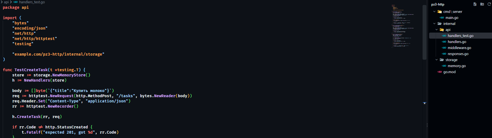

Запустим весь набор тестов из корня проекта:

```powershell
go test ./...
```

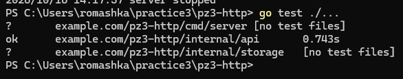

