# ПЗ № 4. Маршрутизация с chi. CRUD-сервис «Список задач»

**Тема работы:** маршрутизация HTTP-запросов с использованием chi (альтернатива — gorilla/mux). Создание небольшого CRUD-сервиса «Список задач».

**Цели работы:**
- Освоим базовую маршрутизацию HTTP-запросов в Go на примере роутера chi.
- Разберёмся с REST-маршрутами и обработкой методов GET, POST, PUT и DELETE.
- Реализуем CRUD-сервис ToDo с хранением данных в памяти без использования БД.
- Добавим middleware для логирования запросов и настройки CORS.
- Проверим работу API через PowerShell, используя HTTP-запросы.
## 1. Создание проекта

Для выполнения практической работы создадим проект `pz4-todo` и разделим код на несколько частей. Модель задачи и работу с хранилищем разместим в `internal/task`, а собственные middleware вынесем в `pkg/middleware`. Точка входа `main.go` будет отвечать за сборку приложения и запуск HTTP-сервера.

Структура проекта:

```
pz4-todo/
├── go.mod
├── main.go
├── internal/
│   └── task/
│       ├── model.go
│       ├── repo.go
│       └── handler.go
└── pkg/
    └── middleware/
        ├── logger.go
        └── cors.go
```

### 1.1. Инициализация модуля и установка зависимостей

Создадим директорию проекта, перейдём в неё и инициализируем Go-модуль. Для маршрутизации установим библиотеку chi версии 5.

```
mkdir pz4-todo
cd pz4-todo

go mod init example.com/pz4-todo
go get github.com/go-chi/chi/v5
go get github.com/go-chi/chi/v5/middleware
```

После выполнения команд получим файл `go.mod`, в котором будут указаны имя модуля и необходимые зависимости.

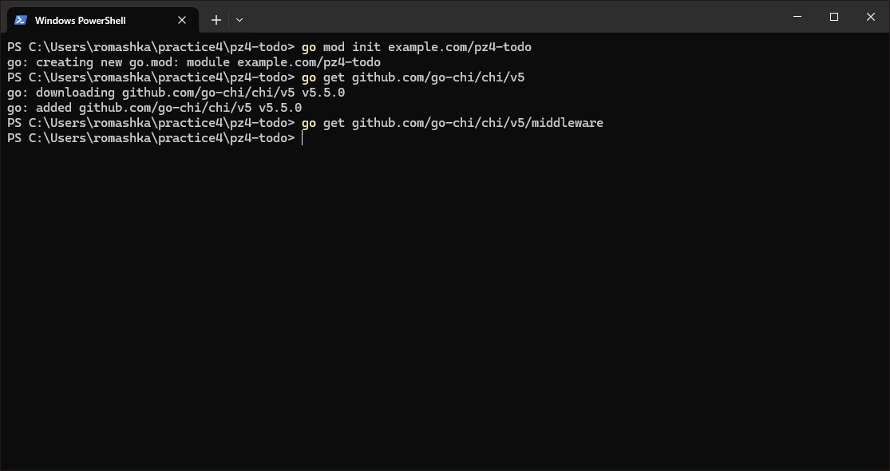
## 2. Модель и хранилище в памяти

Для представления задачи создадим структуру `Task`. Она будет содержать идентификатор, заголовок, статус выполнения и даты создания и последнего обновления.

`internal/task/model.go`

```go
package task

import "time"

// Описываем задачу и её основные поля.
type Task struct {
	ID        int64     `json:"id"`
	Title     string    `json:"title"`
	Done      bool      `json:"done"`
	CreatedAt time.Time `json:"created_at"`
	UpdatedAt time.Time `json:"updated_at"`
}
```

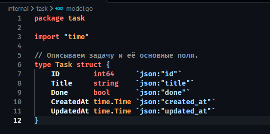

Для хранения задач реализуем репозиторий `Repo`. В качестве хранилища используем map, где ключом будет идентификатор задачи, а значением — указатель на объект `Task`. Счётчик `seq` позволит последовательно выдавать новые идентификаторы.

Поскольку обработчики могут обращаться к хранилищу одновременно, добавим `sync.RWMutex`. Для операций чтения используем `RLock`, а при создании, изменении или удалении задачи — обычную блокировку `Lock`.

`internal/task/repo.go`

```go
package task

import (
	"errors"
	"sync"
	"time"
)

// Возвращаем эту ошибку, если задача отсутствует.
var ErrNotFound = errors.New("task not found")

type Repo struct {
	mu    sync.RWMutex
	seq    int64
	items  map[int64]*Task
}

func NewRepo() *Repo {
	return &Repo{
		items: make(map[int64]*Task),
	}
}

// Получаем список всех задач.
func (r *Repo) List() []*Task {
	r.mu.RLock()
	defer r.mu.RUnlock()

	out := make([]*Task, 0, len(r.items))
	for _, t := range r.items {
		out = append(out, t)
	}

	return out
}

// Ищем задачу по идентификатору.
func (r *Repo) Get(id int64) (*Task, error) {
	r.mu.RLock()
	defer r.mu.RUnlock()

	t, ok := r.items[id]
	if !ok {
		return nil, ErrNotFound
	}

	return t, nil
}

// Создаём задачу с новым идентификатором.
func (r *Repo) Create(title string) *Task {
	r.mu.Lock()
	defer r.mu.Unlock()

	r.seq++
	now := time.Now()

	t := &Task{
		ID:        r.seq,
		Title:     title,
		CreatedAt: now,
		UpdatedAt: now,
		Done:      false,
	}

	r.items[t.ID] = t
	return t
}

// Обновляем заголовок, статус и время изменения.
func (r *Repo) Update(id int64, title string, done bool) (*Task, error) {
	r.mu.Lock()
	defer r.mu.Unlock()

	t, ok := r.items[id]
	if !ok {
		return nil, ErrNotFound
	}

	t.Title = title
	t.Done = done
	t.UpdatedAt = time.Now()

	return t, nil
}

// Удаляем задачу из хранилища.
func (r *Repo) Delete(id int64) error {
	r.mu.Lock()
	defer r.mu.Unlock()

	if _, ok := r.items[id]; !ok {
		return ErrNotFound
	}

	delete(r.items, id)
	return nil
}
```

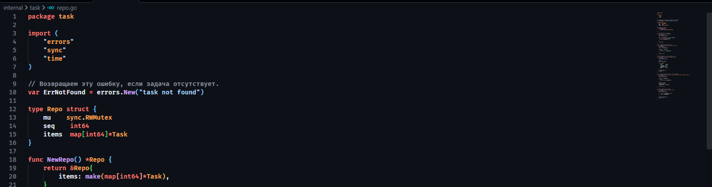

Таким образом, репозиторий предоставляет пять основных операций: получение списка задач, поиск одной задачи, создание, обновление и удаление. Все изменения выполняются непосредственно в памяти, поэтому после остановки сервера данные будут потеряны.
## 3. Handlers: JSON API

Создадим обработчики HTTP-запросов в `internal/task/handler.go`. Они будут связывать REST-маршруты с методами репозитория и возвращать клиенту результаты в формате JSON.

Для работы с параметром `{id}` воспользуемся `chi.URLParam`, а для преобразования идентификатора в `int64` — `strconv.ParseInt`.

`internal/task/handler.go`

```go
package task

import (
	"encoding/json"
	"net/http"
	"strconv"

	"github.com/go-chi/chi/v5"
)

type Handler struct {
	repo *Repo
}

func NewHandler(repo *Repo) *Handler {
	return &Handler{repo: repo}
}

// Определяем маршруты для операций с задачами.
func (h *Handler) Routes() chi.Router {
	r := chi.NewRouter()

	r.Get("/", h.list)          // GET    /tasks
	r.Post("/", h.create)       // POST   /tasks
	r.Get("/{id}", h.get)       // GET    /tasks/{id}
	r.Put("/{id}", h.update)    // PUT    /tasks/{id}
	r.Delete("/{id}", h.delete) // DELETE /tasks/{id}

	return r
}

// Возвращаем список задач.
func (h *Handler) list(w http.ResponseWriter, r *http.Request) {
	writeJSON(w, http.StatusOK, h.repo.List())
}

// Получаем задачу по id.
func (h *Handler) get(w http.ResponseWriter, r *http.Request) {
	id, bad := parseID(w, r)
	if bad {
		return
	}

	t, err := h.repo.Get(id)
	if err != nil {
		httpError(w, http.StatusNotFound, err.Error())
		return
	}

	writeJSON(w, http.StatusOK, t)
}

// Структура входных данных для создания задачи.
type createReq struct {
	Title string `json:"title"`
}

func (h *Handler) create(w http.ResponseWriter, r *http.Request) {
	var req createReq

	if err := json.NewDecoder(r.Body).Decode(&req); err != nil || req.Title == "" {
		httpError(w, http.StatusBadRequest, "invalid json: require non-empty title")
		return
	}

	t := h.repo.Create(req.Title)
	writeJSON(w, http.StatusCreated, t)
}

// Структура входных данных для обновления задачи.
type updateReq struct {
	Title string `json:"title"`
	Done  bool   `json:"done"`
}

func (h *Handler) update(w http.ResponseWriter, r *http.Request) {
	id, bad := parseID(w, r)
	if bad {
		return
	}

	var req updateReq
	if err := json.NewDecoder(r.Body).Decode(&req); err != nil || req.Title == "" {
		httpError(w, http.StatusBadRequest, "invalid json: require non-empty title")
		return
	}

	t, err := h.repo.Update(id, req.Title, req.Done)
	if err != nil {
		httpError(w, http.StatusNotFound, err.Error())
		return
	}

	writeJSON(w, http.StatusOK, t)
}

// Удаляем задачу по id.
func (h *Handler) delete(w http.ResponseWriter, r *http.Request) {
	id, bad := parseID(w, r)
	if bad {
		return
	}

	if err := h.repo.Delete(id); err != nil {
		httpError(w, http.StatusNotFound, err.Error())
		return
	}

	w.WriteHeader(http.StatusNoContent)
}

// Проверяем и преобразуем идентификатор из URL.
func parseID(w http.ResponseWriter, r *http.Request) (int64, bool) {
	raw := chi.URLParam(r, "id")
	id, err := strconv.ParseInt(raw, 10, 64)

	if err != nil || id <= 0 {
		httpError(w, http.StatusBadRequest, "invalid id")
		return 0, true
	}

	return id, false
}

// Отправляем JSON с указанным HTTP-статусом.
func writeJSON(w http.ResponseWriter, code int, v any) {
	w.Header().Set("Content-Type", "application/json; charset=utf-8")
	w.WriteHeader(code)

	_ = json.NewEncoder(w).Encode(v)
}

// Формируем единый формат ответа с ошибкой.
func httpError(w http.ResponseWriter, code int, msg string) {
	writeJSON(w, code, map[string]string{"error": msg})
}
```

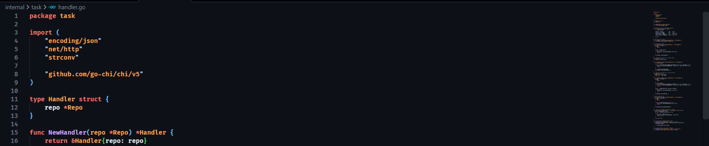

В обработчиках реализована следующая логика:

- `GET /tasks` возвращает список задач с кодом `200 OK`.
- `POST /tasks` создаёт задачу и возвращает `201 Created`.
- `GET /tasks/{id}` возвращает конкретную задачу.
- `PUT /tasks/{id}` изменяет заголовок и статус выполнения.
- `DELETE /tasks/{id}` удаляет задачу и возвращает `204 No Content`.

Если идентификатор некорректный или отсутствует в хранилище, обработчик вернёт соответствующий код ошибки. Для невалидного JSON и пустого заголовка предусмотрен ответ `400 Bad Request`.
## 4. Middleware: логирование и CORS

Для обработки запросов добавим два собственных middleware. Первое будет фиксировать HTTP-метод, путь и время выполнения запроса. Второе настроит CORS, чтобы разрешить обращения к API с других источников.

`pkg/middleware/logger.go`

```go
package middleware

import (
	"log"
	"net/http"
	"time"
)

// Замеряем время обработки каждого запроса.
func Logger(next http.Handler) http.Handler {
	return http.HandlerFunc(func(w http.ResponseWriter, r *http.Request) {
		start := time.Now()

		next.ServeHTTP(w, r)

		log.Printf(
			"%s %s %s",
			r.Method,
			r.URL.Path,
			time.Since(start),
		)
	})
}
```
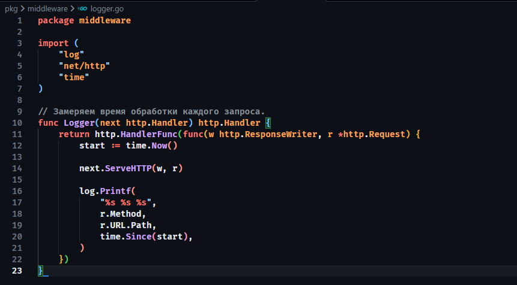

`pkg/middleware/cors.go`

```go
package middleware

import "net/http"

// Разрешаем запросы с других источников.
func SimpleCORS(next http.Handler) http.Handler {
	return http.HandlerFunc(func(w http.ResponseWriter, r *http.Request) {
		w.Header().Set("Access-Control-Allow-Origin", "*")
		w.Header().Set(
			"Access-Control-Allow-Methods",
			"GET,POST,PUT,DELETE,OPTIONS",
		)
		w.Header().Set(
			"Access-Control-Allow-Headers",
			"Content-Type, Authorization",
		)

		// OPTIONS обрабатываем без передачи дальше.
		if r.Method == http.MethodOptions {
			w.WriteHeader(http.StatusNoContent)
			return
		}

		next.ServeHTTP(w, r)
	})
}
```

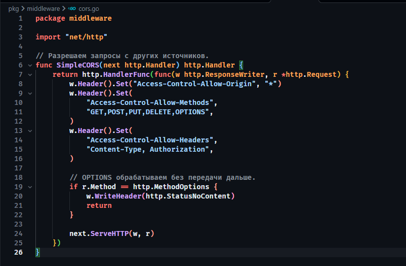

В `Logger` сначала фиксируется время начала запроса, после чего управление передаётся следующему обработчику. Когда обработка завершается, в журнал выводится информация о запросе и затраченном времени.

В `SimpleCORS` устанавливаются заголовки, разрешающие обращения с любых источников, использование методов GET, POST, PUT, DELETE и OPTIONS, а также передачу `Content-Type` и `Authorization`. Запросы OPTIONS завершаются с кодом `204 No Content` без вызова основного обработчика.
## 5. main.go: сборка приложения

В `main.go` объединим созданные компоненты. Сначала инициализируем репозиторий и обработчик задач, затем создадим основной роутер chi и подключим встроенные и собственные middleware.

После этого смонтируем маршруты задач по адресу `/tasks` и запустим HTTP-сервер на порту `8080`.

```go
package main

import (
	"log"
	"net/http"

	"github.com/go-chi/chi/v5"
	chimw "github.com/go-chi/chi/v5/middleware"

	"example.com/pz4-todo/internal/task"
	myMW "example.com/pz4-todo/pkg/middleware"
)

func main() {
	repo := task.NewRepo()
	h := task.NewHandler(repo)

	r := chi.NewRouter()

	// Подключаем встроенные middleware chi.
	r.Use(chimw.RequestID)
	r.Use(chimw.RealIP)
	r.Use(chimw.Recoverer)

	// Подключаем логирование и CORS.
	r.Use(myMW.Logger)
	r.Use(myMW.SimpleCORS)

	// Все маршруты задач будут доступны через /tasks.
	r.Mount("/tasks", h.Routes())

	log.Println("Server started on :8080")

	if err := http.ListenAndServe(":8080", r); err != nil {
		log.Fatal(err)
	}
}
```

Встроенные middleware chi отвечают за идентификатор запроса, получение реального IP-адреса клиента и восстановление работы сервера при панике в обработчике. Наши middleware дополняют эту обработку логированием и настройкой CORS.
## 6. Запуск сервера

Перед запуском проверим зависимости и приведём модуль в актуальное состояние. Затем запустим приложение.

```powershell
go mod tidy
go run .
```

После выполнения команды сервер начнёт принимать запросы на порту `8080`.

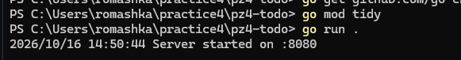
## 7. Примеры запросов и ответы

Для проверки API воспользуемся PowerShell. Сохраним адрес сервера в переменной `$base`, чтобы не указывать его заново в каждом запросе.

```powershell
$base = "http://localhost:8080"
```

### 7.1. Создание задачи (POST /tasks)

Сначала отправим запрос на создание задачи «Купить молоко». В теле запроса передадим JSON с полем `title`, а затем выведем код ответа и содержимое.

```powershell
$body = '{"title":"Conquer Poland"}'

$resp = Invoke-WebRequest -Uri "$base/tasks" `
    -Method Post `
    -ContentType "application/json" `
    -Body $body `
    -UseBasicParsing

$resp.StatusCode
$resp.Content
```

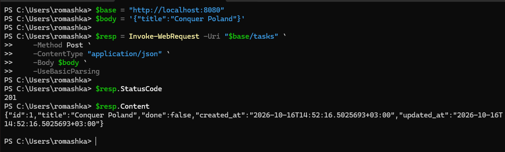
Создадим ещё одну задачу, чтобы проверить работу сервиса с несколькими записями.

```go
$body2 = '{"title":"Practice #4"}'

$resp2 = Invoke-WebRequest -Uri "$base/tasks" `
    -Method Post `
    -ContentType "application/json" `
    -Body $body2 `
    -UseBasicParsing

$resp2.StatusCode
$resp2.Content
```

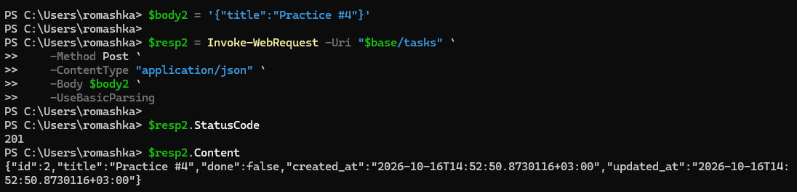
### 7.2. Получение списка (GET /tasks)

Получим все задачи, которые находятся в хранилище. Ответ преобразуем из JSON и отформатируем для удобного просмотра.

```powershell
$resp = Invoke-WebRequest -Uri "$base/tasks" `
    -Method Get `
    -UseBasicParsing

$resp.StatusCode
$resp.Content | ConvertFrom-Json | ConvertTo-Json -Depth 5
```

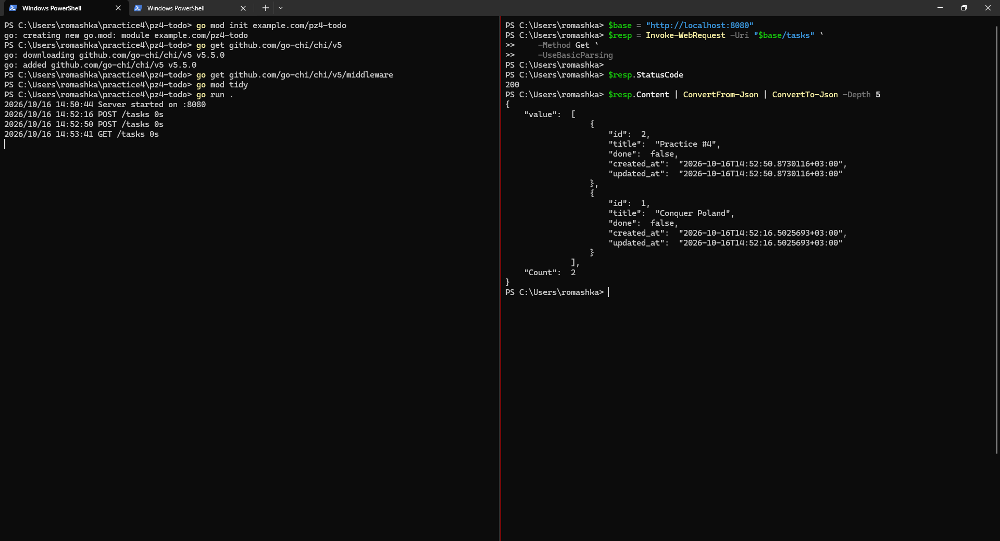
### 7.3. Получение одной задачи (GET /tasks/)

Проверим получение конкретной задачи по идентификатору. Для этого отправим GET-запрос по адресу `/tasks/1`.

```powershell
$resp = Invoke-WebRequest -Uri "$base/tasks/1" `
    -Method Get `
    -UseBasicParsing

$resp.StatusCode
$resp.Content | ConvertFrom-Json | ConvertTo-Json -Depth 5
```

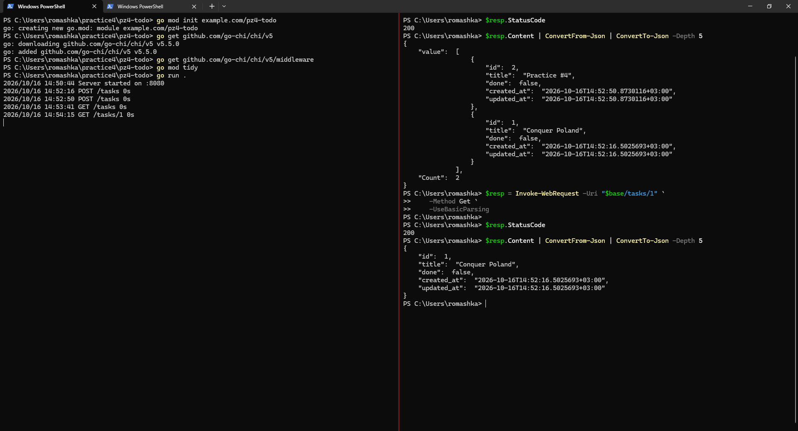
### 7.4. Обновление задачи (PUT /tasks/)

Изменим заголовок первой задачи и отметим её как выполненную. В запросе передадим новое значение `title` и `done: true`.

```powershell
$body = '{"title":"Conquer Poland","done":true}'

$resp = Invoke-WebRequest -Uri "$base/tasks/1" `
    -Method Put `
    -ContentType "application/json" `
    -Body $body `
    -UseBasicParsing

$resp.StatusCode
$resp.Content | ConvertFrom-Json | ConvertTo-Json -Depth 5
```

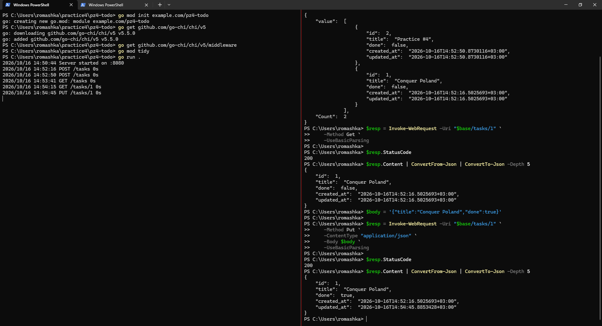
### 7.5. Удаление задачи (DELETE /tasks/)

Удалим вторую задачу, отправив DELETE-запрос по адресу `/tasks/2`. В случае успешного удаления сервер вернёт код `204 No Content`.

```powershell
$resp = Invoke-WebRequest -Uri "$base/tasks/2" `
    -Method Delete `
    -UseBasicParsing

$resp.StatusCode
$resp.Content
```

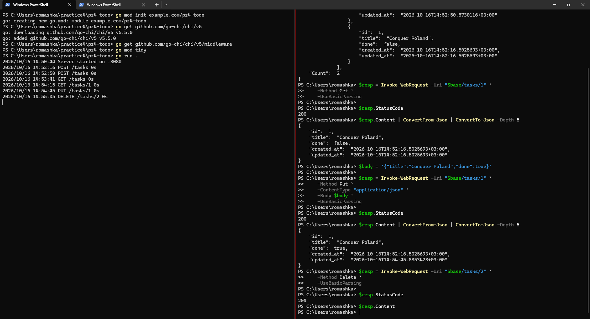
## 8. Проверка обработки ошибок

Дополнительно проверим, как сервис реагирует на некорректные запросы. Для этого отправим запросы с пустым заголовком, неправильным идентификатором и идентификатором задачи, которой нет в хранилище.
### 8.1. Пустой заголовок -> 400

Попробуем создать задачу с пустым значением `title`. В обработчике предусмотрена проверка, которая должна вернуть `400 Bad Request`.

```powershell
$body = '{"title":""}'

curl.exe -s -o - -w "`n%{http_code}" `
    -X POST "$base/tasks" `
    -H "Content-Type: application/json" `
    -d $body
```

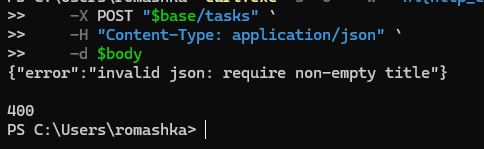
Получаем ошибку `400 Bad Request`, поскольку заголовок задачи не заполнен.
### 8.2. Некорректный id -> 400

Отправим GET-запрос с идентификатором `abc`. Так как идентификатор должен быть положительным числом, обработчик `parseID` вернёт ошибку `400 Bad Request`.

```powershell
curl.exe -s -w "`n%{http_code}" "$base/tasks/abc"
```

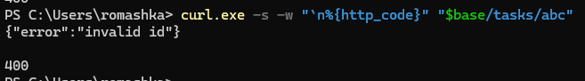

Получаем ошибку `400 Bad Request`, так как строку `abc` невозможно преобразовать в числовой идентификатор.
### 8.3. Несуществующая задача -> 404

Теперь попробуем получить задачу с идентификатором `999`, которой нет в хранилище. В этом случае репозиторий вернёт `ErrNotFound`, а обработчик преобразует ошибку в HTTP-ответ `404 Not Found`.

```powershell
curl.exe -s -w "`n%{http_code}" "$base/tasks/999"
```

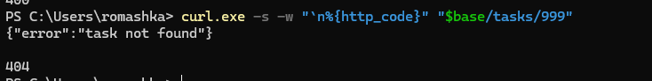

Получаем ошибку `404 Not Found`, поскольку задача с указанным идентификатором отсутствует в репозитории.

## 9. Вывод

В ходе практической работы мы освоили базовую маршрутизацию HTTP-запросов в Go с использованием библиотеки chi и реализовали небольшой CRUD-сервис «Список задач». Для хранения данных использовали репозиторий на основе map с синхронизацией доступа через `sync.RWMutex`.

Реализовали обработчики для создания, получения, обновления и удаления задач, а также добавили middleware для логирования запросов и настройки CORS. В завершение проверили работу API через PowerShell, убедились в корректной обработке основных HTTP-методов и рассмотрели ответы сервера при ошибках `400 Bad Request` и `404 Not Found`.