|        |              |
| :----: | :----------- |
|  Имя   | Акулов Роман |
| Группа | ЭФМО-01-26   |
# Использование ORM (GORM). Модели, миграции и связи между таблицами

## Краткое описание работы

**ORM (Object-Relational Mapping)** — технология, которая связывает объекты программы, представленные структурами Go, с таблицами реляционной базы данных. Вместо того чтобы вручную писать SQL для каждой операции, мы описываем модели и работаем с ними через методы ORM, которая формирует необходимые запросы.

В работе используем **GORM** — популярную ORM-библиотеку для Go. С её помощью можно выполнять CRUD-операции, создавать таблицы на основе структур через `AutoMigrate` и описывать связи между сущностями: один к одному, один ко многим и многие ко многим. Для получения связанных записей предусмотрен метод `Preload`.

Главное преимущество ORM — сокращение количества шаблонного кода и ускорение разработки. Кроме того, GORM позволяет использовать параметризованные запросы, что помогает защититься от SQL-инъекций. При этом для сложных аналитических запросов, агрегаций и оконных функций ручной SQL может оказаться удобнее.
## 1. Создание базы данных в PostgreSQL

Сначала откроем `psql` под пользователем `postgres` и создадим отдельную базу данных для практической работы.

```
CREATE DATABASE pz6_gorm;
```

Проверим, что база появилась в списке доступных баз данных:

```
\l
```

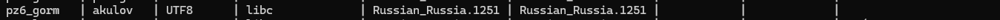

## 2. Инициализация проекта и установка зависимостей

Создадим каталог проекта и инициализируем Go-модуль. Для работы нам понадобятся GORM, драйвер PostgreSQL и маршрутизатор `chi`, который будем использовать для организации HTTP-эндпоинтов.

```
mkdir pz6-gorm
cd pz6-gorm

go mod init example.com/pz6-gorm

go get gorm.io/gorm
go get gorm.io/driver/postgres
go get github.com/go-chi/chi/v5
```

После установки зависимостей Go добавит необходимые записи в `go.mod` и `go.sum`. Эти файлы вместе с исходным кодом будем хранить в Git-репозитории.

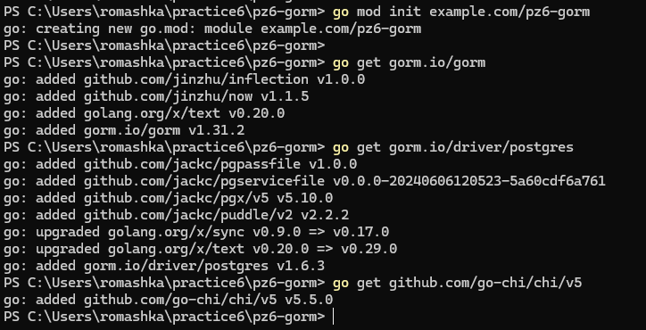
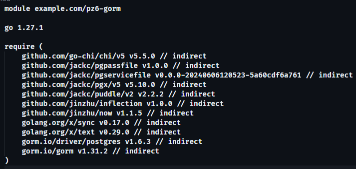
## 3. Структура проекта

Разделим приложение на несколько частей: запуск сервера, подключение к базе данных, описание моделей и обработку HTTP-запросов. Такая структура позволяет не смешивать работу с БД и обработку запросов в одном файле.

```
pz6-gorm/
├── cmd/
│   └── server/
│       └── main.go
├── internal/
│   ├── db/
│   │   └── postgres.go
│   ├── models/
│   │   └── models.go
│   └── httpapi/
│       ├── router.go
│       └── handlers.go
├── go.mod
└── go.sum
```

Создадим необходимые каталоги и файлы средствами PowerShell:

```bash
mkdir -pv cmd/server internal/db internal/models internal/httpapi

touch cmd/server/main.go
touch internal/db/postgres.go
touch internal/models/models.go
touch internal/httpapi/router.go
touch internal/httpapi/handlers.go
```

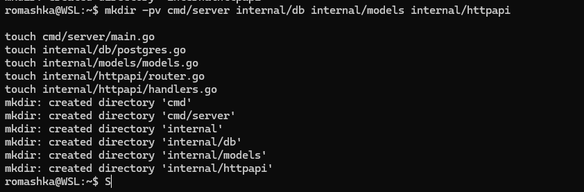

Файл `main.go` будет точкой входа в приложение, `postgres.go` — отвечать за подключение к PostgreSQL, а `models.go` — содержать структуры данных. В `router.go` зарегистрируем маршруты, а в `handlers.go` разместим обработчики запросов.

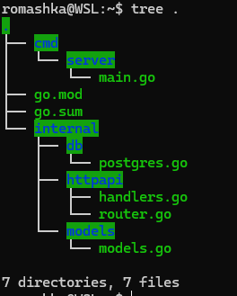
## 4. Подключение к PostgreSQL через GORM

В файле `internal/db/postgres.go` реализуем функцию подключения к базе данных. Строку подключения будем получать из переменной окружения `DB_DSN`, чтобы не хранить параметры соединения непосредственно в исходном коде.

```go
package db

import (
	"log"
	"os"
	"time"

	"gorm.io/driver/postgres"
	"gorm.io/gorm"
	"gorm.io/gorm/logger"
)

func Connect() *gorm.DB {
	// Получаем строку подключения из окружения.
	dsn := os.Getenv("DB_DSN")
	if dsn == "" {
		log.Fatal("DB_DSN is empty; check the .env file")
	}

	db, err := gorm.Open(postgres.Open(dsn), &gorm.Config{
		Logger: logger.Default.LogMode(logger.Warn),
	})
	if err != nil {
		log.Fatal("connect db:", err)
	}

	// Настраиваем пул соединений.
	sqlDB, err := db.DB()
	if err != nil {
		log.Fatal(err)
	}

	sqlDB.SetMaxOpenConns(20)
	sqlDB.SetMaxIdleConns(10)
	sqlDB.SetConnMaxLifetime(time.Hour)

	return db
}
```

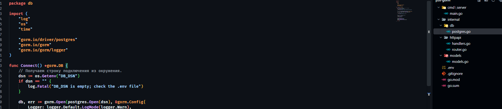

В функции `Connect()` сначала проверяем наличие строки подключения, затем открываем соединение через драйвер PostgreSQL. Дополнительно настраиваем пул соединений: максимум 20 открытых и 10 свободных соединений, время жизни соединения — один час.

Параметры соединения вынесем в `.env`, чтобы не прописывать их в коде и не задавать вручную при каждом запуске приложения. Для чтения переменных окружения из файла установим библиотеку `godotenv`:
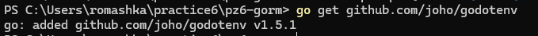

В корне проекта создадим файл `.env` со следующими настройками:

```ruby
DB_DSN=host=127.0.0.1 user=akulov password=admin dbname=pz6_gorm port=5432 sslmode=disable
```

Чтобы Git не добавлял файл с настройками подключения в репозиторий, создадим `.gitignore` в корне проекта:

```bash
# Переменные окружения и секреты
.env
.env.*

# Исключаем пример конфигурации из общего правила
!.env.example

# Сгенерированные файлы и локальные артефакты
*.exe
*.test
coverage.out
```
## 5. Модели и связи

Опишем три сущности: пользователя, заметку и тег. Один пользователь может создать несколько заметок, а каждая заметка может содержать несколько тегов. При этом один и тот же тег можно использовать в разных заметках.

В файле `internal/models/models.go` разместим следующие структуры:

```go
package models

import "time"

// User - автор заметок: один пользователь может иметь много заметок.
type User struct {
	ID        uint   `gorm:"primaryKey"`
	Name      string `gorm:"size:100;not null"`
	Email     string `gorm:"size:200;uniqueIndex;not null"`
	Notes     []Note
	CreatedAt time.Time
	UpdatedAt time.Time
}

// Note - заметка, принадлежащая пользователю и связанная с тегами.
type Note struct {
	ID        uint   `gorm:"primaryKey"`
	Title     string `gorm:"size:200;not null"`
	Content   string `gorm:"type:text"`
	UserID    uint   `gorm:"not null"`
	User      User
	Tags      []Tag `gorm:"many2many:note_tags;"`
	CreatedAt time.Time
	UpdatedAt time.Time
}

// Tag - тег, который может использоваться в разных заметках.
type Tag struct {
	ID        uint   `gorm:"primaryKey"`
	Name      string `gorm:"size:50;uniqueIndex;not null"`
	Notes     []Note `gorm:"many2many:note_tags;"`
	CreatedAt time.Time
	UpdatedAt time.Time
}
```

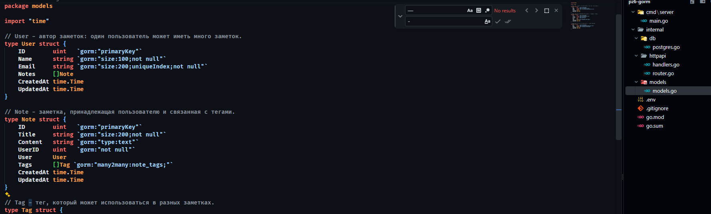

Связь между `User` и `Note` реализована через поле `UserID`, которое хранит идентификатор автора. Поля `Notes` и `User` позволяют GORM определить связь один ко многим.

Для связи заметок с тегами используется отношение многие ко многим. Тег `gorm:"many2many:note_tags;"` указывает GORM на промежуточную таблицу `note_tags`, через которую будут связываться записи из `notes` и `tags`.

Поля `CreatedAt` и `UpdatedAt` предназначены для хранения времени создания и последнего обновления записи. GORM автоматически заполняет их при стандартных операциях создания и обновления.
## 6. AutoMigrate и запуск сервера

В точке входа `cmd/server/main.go` подключимся к БД, выполним миграцию моделей и запустим HTTP-сервер.

```go
package main

import (
	"log"
	"net/http"

	"github.com/joho/godotenv"

	"example.com/pz6-gorm/internal/db"
	httpapi "example.com/pz6-gorm/internal/httpapi"
	"example.com/pz6-gorm/internal/models"
)

func main() {
	// Загружаем настройки из .env в корне проекта.
	if err := godotenv.Load(); err != nil {
		log.Println(".env not found; using system environment")
	}

	d := db.Connect()

	// Создаём таблицы и необходимые связи.
	if err := d.AutoMigrate(
		&models.User{},
		&models.Note{},
		&models.Tag{},
	); err != nil {
		log.Fatal("migrate:", err)
	}

	r := httpapi.BuildRouter(d)

	log.Println("listening on :8080")
	log.Fatal(http.ListenAndServe(":8080", r))
}
```

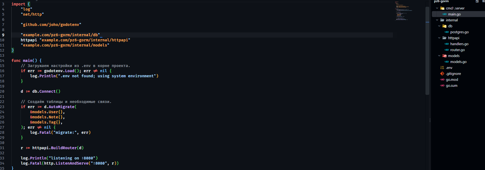

Метод `AutoMigrate` анализирует переданные модели и создаёт необходимые таблицы, столбцы, индексы и ограничения. В нашем случае это таблицы пользователей, заметок, тегов и промежуточная таблица для связи заметок с тегами.

Миграцию выполняем до запуска HTTP-сервера, чтобы обработчики не начали работать с ещё не созданными таблицами.
## 7. Роутер и хендлеры (минимальный REST)

Настроим маршруты в файле `internal/httpapi/router.go`. Для этого создадим маршрутизатор `chi` и зарегистрируем обработчики проверки состояния сервера, создания пользователей и заметок, а также получения заметки по идентификатору.

**Файл** `internal/httpapi/router.go`:

```go
package httpapi

import (
	"github.com/go-chi/chi/v5"
	"gorm.io/gorm"
)

func BuildRouter(d *gorm.DB) *chi.Mux {
	r := chi.NewRouter()
	h := NewHandlers(d)

	r.Get("/health", h.Health)
	r.Post("/users", h.CreateUser)
	r.Post("/notes", h.CreateNote)
	r.Get("/notes/{id}", h.GetNoteByID)

	return r
}
```

Теперь реализуем обработчики в `internal/httpapi/handlers.go`. Для ответов будем использовать JSON, а ошибки возвращать с соответствующим HTTP-статусом.

```go
package httpapi

import (
	"encoding/json"
	"net/http"
	"strconv"

	"github.com/go-chi/chi/v5"
	"gorm.io/gorm"

	"example.com/pz6-gorm/internal/models"
)

type Handlers struct {
	db *gorm.DB
}

func NewHandlers(db *gorm.DB) *Handlers {
	return &Handlers{db: db}
}

func (h *Handlers) Health(w http.ResponseWriter, r *http.Request) {
	writeJSON(w, http.StatusOK, map[string]string{
		"status": "ok",
	})
}

type createUserReq struct {
	Name  string `json:"name"`
	Email string `json:"email"`
}

func (h *Handlers) CreateUser(w http.ResponseWriter, r *http.Request) {
	var in createUserReq

	if err := json.NewDecoder(r.Body).Decode(&in); err != nil ||
		in.Name == "" || in.Email == "" {
		writeErr(w, http.StatusBadRequest, "name and email are required")
		return
	}

	u := models.User{
		Name:  in.Name,
		Email: in.Email,
	}

	if err := h.db.Create(&u).Error; err != nil {
		writeErr(w, http.StatusConflict, err.Error())
		return
	}

	writeJSON(w, http.StatusCreated, u)
}

type createNoteReq struct {
	Title   string   `json:"title"`
	Content string   `json:"content"`
	UserID  uint     `json:"userId"`
	Tags    []string `json:"tags"`
}

func (h *Handlers) CreateNote(w http.ResponseWriter, r *http.Request) {
	var in createNoteReq

	if err := json.NewDecoder(r.Body).Decode(&in); err != nil ||
		in.Title == "" || in.UserID == 0 {
		writeErr(w, http.StatusBadRequest, "title and userId are required")
		return
	}

	// Находим существующие теги или создаём новые.
	var tags []models.Tag

	for _, name := range in.Tags {
		if name == "" {
			continue
		}

		t := models.Tag{Name: name}
		if err := h.db.FirstOrCreate(&t, models.Tag{Name: name}).Error; err == nil {
			tags = append(tags, t)
		}
	}

	note := models.Note{
		Title:   in.Title,
		Content: in.Content,
		UserID:  in.UserID,
		Tags:    tags,
	}

	if err := h.db.Create(&note).Error; err != nil {
		writeErr(w, http.StatusBadRequest, err.Error())
		return
	}

	// Подгружаем автора и теги для полного ответа.
	if err := h.db.Preload("User").
		Preload("Tags").
		First(&note, note.ID).Error; err != nil {
		writeErr(w, http.StatusInternalServerError, err.Error())
		return
	}

	writeJSON(w, http.StatusCreated, note)
}

func (h *Handlers) GetNoteByID(w http.ResponseWriter, r *http.Request) {
	idStr := chi.URLParam(r, "id")
	id, err := strconv.Atoi(idStr)

	if err != nil || id <= 0 {
		writeErr(w, http.StatusBadRequest, "bad id")
		return
	}

	var note models.Note

	if err := h.db.Preload("User").
		Preload("Tags").
		First(&note, id).Error; err != nil {
		writeErr(w, http.StatusNotFound, "note not found")
		return
	}

	writeJSON(w, http.StatusOK, note)
}

// ---------- Вспомогательные функции ----------

type jsonErr struct {
	Error string `json:"error"`
}

func writeJSON(w http.ResponseWriter, code int, v any) {
	w.Header().Set("Content-Type", "application/json; charset=utf-8")
	w.WriteHeader(code)
	_ = json.NewEncoder(w).Encode(v)
}

func writeErr(w http.ResponseWriter, code int, msg string) {
	writeJSON(w, code, jsonErr{Error: msg})
}
```

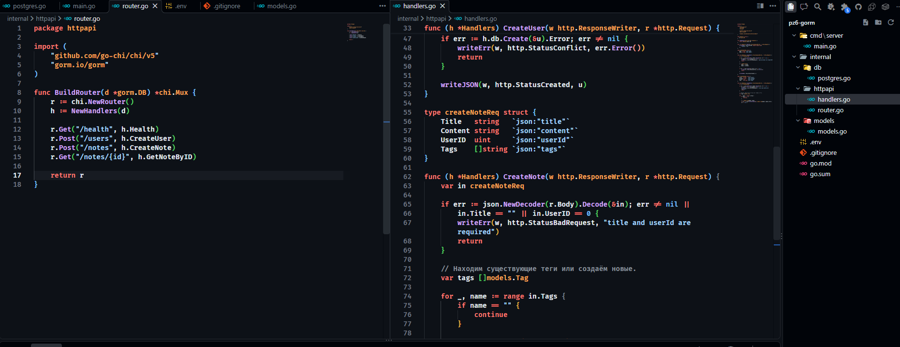

Обработчик `CreateUser` принимает имя и электронную почту, проверяет наличие обязательных полей и сохраняет пользователя через `Create`. Для заметок используется отдельная структура запроса, содержащая заголовок, текст, идентификатор автора и список тегов. Метод `FirstOrCreate` позволяет найти существующий тег или создать новый. После сохранения заметки вызываем `Preload("User")` и `Preload("Tags")`, чтобы получить связанные записи и вернуть их клиенту вместе с самой заметкой.

> [!info] Используемые HTTP-эндпоинты
> - `GET /health` — проверка состояния сервера.
> - `POST /users` — создание пользователя.
> - `POST /notes` — создание заметки с тегами.    
> - `GET /notes/{id}` — получение заметки вместе с автором и тегами.
## 8. Запуск сервера

Перед запуском укажем строку подключения к созданной базе данных и выполним приложение из корня проекта:

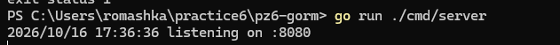
## 9. Проверка API
### 9.1. Проверка эндпоинта /health

Сначала убедимся, что сервер принимает запросы и возвращает статус `ok`.

```powershell
curl.exe -s "http://localhost:8080/health"
```

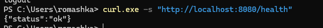
### 9.2. Создание пользователя

Отправим POST-запрос с именем пользователя и электронной почтой. Тело запроса передадим в формате JSON.

```powershell
$body = '{"name":"Alice","email":"alice@example.com"}'

Invoke-WebRequest -Uri "http://localhost:8080/users" `
    -Method POST `
    -ContentType "application/json" `
    -Body $body |
    Select-Object -ExpandProperty Content
```

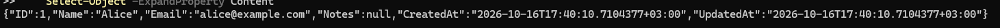

При успешном выполнении сервер вернёт созданную запись и статус `201 Created`.
### 9.3. Создание заметки с тегами

Теперь создадим заметку, указав идентификатор ранее созданного пользователя и два тега. В примере используется `userId: 1`, поскольку первая созданная запись обычно получает такой идентификатор в пустой таблице.

```powershell
$body = '{"title":"First note","content":"Example...","userId":1,"tags":["go","gorm"]}'

Invoke-WebRequest -Uri "http://localhost:8080/notes" `
    -Method POST `
    -ContentType "application/json" `
    -Body $body |
    Select-Object -ExpandProperty Content
```

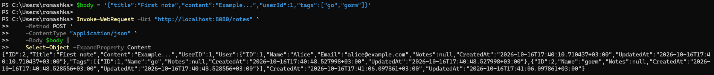

Обработчик сохранит заметку, создаст отсутствующие теги и установит связи между ними. В ответе получим объект заметки с данными автора и тегов.
### 9.4. Получение заметки с автором и тегами

Проверим получение созданной записи отдельным GET-запросом:

```powershell
Invoke-WebRequest -Uri "http://localhost:8080/notes/2" -Method GET |
    Select-Object -ExpandProperty Content
```

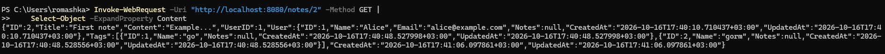
В ответе должна вернуться та же заметка. Благодаря `Preload("User").Preload("Tags")` JSON будет содержать также сведения об авторе и связанных тегах.
## 10. Проверка схемы БД

После проверки API посмотрим, какие таблицы и ограничения создал GORM. Для этого подключимся к базе `pz6_gorm` через `psql` и выполним несколько команд:

```sql
\c pz6_gorm

\dt

\d users
\d notes
\d tags
\d note_tags
```

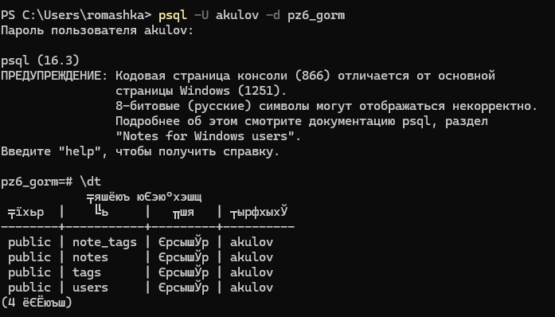
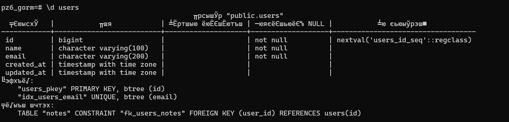
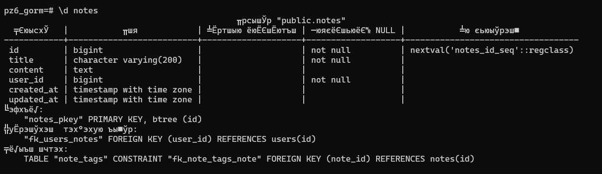
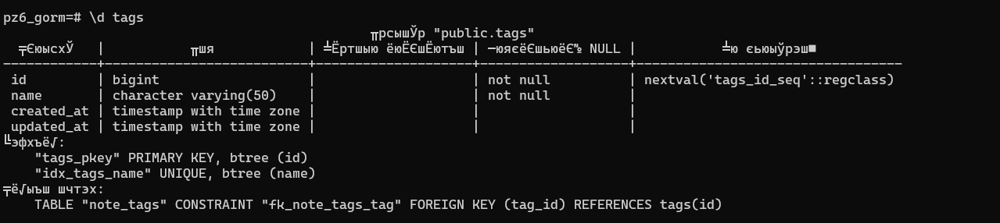
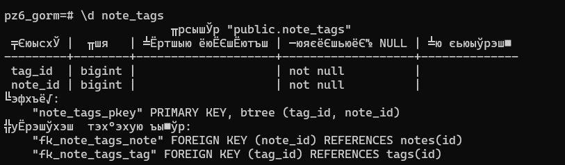В результате должны быть доступны четыре таблицы: `users`, `notes`, `tags` и `note_tags`. В таблице `notes` находится внешний ключ `user_id`, связывающий заметку с автором. Промежуточная таблица `note_tags` содержит идентификаторы заметок и тегов, обеспечивая связь многие ко многим.
## Проблемы и их решения

**Проблема 1.** При запуске появляется ошибка `DB_DSN is empty`.
**Решение.** Проверим, задана ли переменная окружения. Если использовали `setx`, откроем новый терминал. Для текущей сессии можно повторно присвоить значение через `$env:DB_DSN`.

**Проблема 2.** При повторном создании пользователя с тем же адресом получаем ошибку `duplicate key value violates unique constraint "idx_users_email"`.
**Решение.** Это ожидаемое поведение: в модели `User` поле `Email` помечено тегом `uniqueIndex`. Обработчик возвращает HTTP `409 Conflict`, а для проверки создадим пользователя с другим адресом электронной почты.

**Проблема 3.** При первом запуске появляется ошибка `relation "users" does not exist`.
**Решение.** Проверим, что `AutoMigrate` вызывается в `main.go` до запуска HTTP-сервера и что приложение подключается именно к базе `pz6_gorm`, а не к служебной базе `postgres`.

## Ответы на контрольные вопросы

**1. Что такое ORM и зачем она нужна, если есть** `**database/sql**`**? Плюсы и минусы.**

ORM — это слой между программой и реляционной базой данных, который связывает структуры языка с таблицами и формирует SQL-запросы. В отличие от непосредственной работы через `database/sql`, использование ORM позволяет сократить количество шаблонного кода и удобнее описывать модели, связи и типовые операции.

Основные преимущества ORM — упрощение CRUD-операций, поддержка связей и миграций, а также параметризация запросов, помогающая предотвращать SQL-инъекции. К недостаткам относятся дополнительные накладные расходы, менее очевидный SQL и ограничения при построении сложных запросов. Поэтому для нетривиальных агрегаций и аналитики может потребоваться ручной SQL.

**2. Как описать связи 1 и M в GORM?**

Связь один ко многим описывается через поле-срез в родительской модели и внешний ключ в дочерней. В нашей работе пользователь содержит `Notes []Note`, а заметка — поле `UserID uint`.

Связь многие ко многим задаётся срезами в обеих моделях и тегом `gorm:"many2many:note_tags;"`. GORM использует промежуточную таблицу `note_tags`, которая хранит пары идентификаторов связанных заметок и тегов.

**3. Что делает** `**AutoMigrate**`**? Когда его недостаточно?**

`AutoMigrate` создаёт отсутствующие таблицы и столбцы, а также необходимые индексы и ограничения. При этом метод не удаляет неиспользуемые столбцы и не выполняет произвольное изменение существующих типов данных.

Если нужно удалить столбец, преобразовать данные, изменить структуру со сложными зависимостями или обеспечить откат миграции, одного `AutoMigrate` недостаточно. Для таких задач подходят специализированные инструменты, например `golang-migrate` и `goose`, либо подготовленные вручную SQL-миграции.

**4. Чем** `**Preload**` **отличается от** `**Find**` **и** `**First**`**?**

`Find` и `First` получают записи основной модели. Сами по себе эти методы не гарантируют загрузку связанных сущностей. `Preload` дополнительно загружает указанную связь отдельным запросом и заполняет соответствующее поле структуры.

Например, `Preload("User").Preload("Tags")` позволяет получить заметку вместе с автором и тегами. Это удобно, когда необходимо вернуть клиенту полные данные, а не только идентификаторы связанных записей.

**5. Как обработать ошибку нарушения уникального индекса?**

При попытке сохранить повторяющееся значение PostgreSQL возвращает ошибку нарушения уникальности. В GORM её можно проверить после вызова `Create` и преобразовать в подходящий HTTP-ответ, например `409 Conflict`.

Для более точной обработки можно включить `TranslateError: true` в конфигурации GORM и проверять `errors.Is(err, gorm.ErrDuplicatedKey)`. Другой вариант — анализировать ошибку драйвера PostgreSQL, в которой нарушение уникальности соответствует коду `23505`. Такой подход надёжнее, чем проверка текста сообщения об ошибке.