|        |              |
| :----: | :----------- |
|  Имя   | Акулов Роман |
| Группа | ЭФМО-01-26   |
**Цель работы:**
- Освоить базовые операции работы с Redis из Go-приложения.
- Научиться использовать команды `SET`, `GET` и задавать время жизни ключей (`TTL`).
- Реализовать кэширование данных для ускорения работы API.
- Разобраться, как кэш помогает уменьшить нагрузку на основную базу данных.
## 1. Установка и запуск Redis

Запустим Redis в Docker, указав имя контейнера и порт для подключения:

```bash
sudo docker rm -f redis
sudo docker run --name redis -p 6380:6379 -d redis
```

Проверим, что контейнер запущен:

```bash
docker ps
```

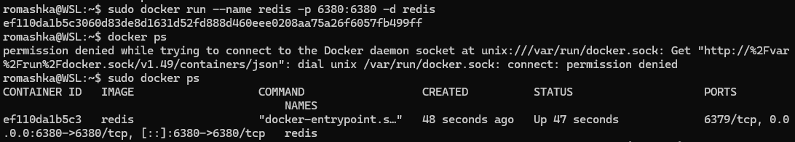

Проверим основные команды непосредственно через `redis-cli`. Сохраним значение пользователя, получим его и создадим ключ с ограниченным временем жизни:

```
docker exec -it redis redis-cli SET user:1 "Alice"
docker exec -it redis redis-cli GET user:1

docker exec -it redis redis-cli SETEX session:123 60 "token_abc"
docker exec -it redis redis-cli TTL session:123
```

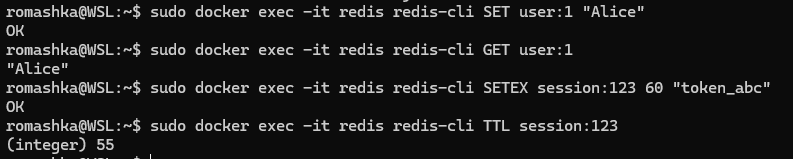

Убедились, что Redis сохраняет и возвращает значения, а также позволяет задавать TTL для ключей.

## 2. Инициализация Go-проекта

Создадим проект `pz7-redis` и подключим библиотеку `go-redis/v9`, с помощью которой Go-приложение будет взаимодействовать с Redis:

```
mkdir pz7-redis
cd pz7-redis

go mod init example.com/pz7-redis
go get github.com/redis/go-redis/v9
```

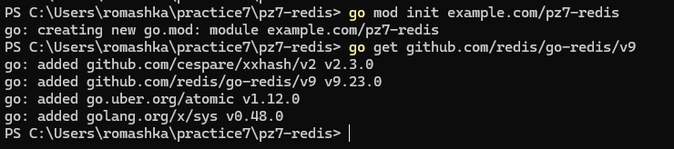

Подготовим структуру проекта. В каталоге `cmd/server` разместим точку входа HTTP-сервера, а в `internal/cache` — реализацию кэша.

```
pz7-redis/
├── cmd/
│   └── server/
│       └── main.go
├── internal/
│   └── cache/
│       └── cache.go
├── go.mod
└── go.sum
```

Создадим необходимые каталоги и файлы:

```bash
mkdir -pv cmd/server internal/cache
touch cmd/server/main.go
touch internal/cache/cache.go
```

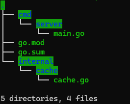
## 3. Реализация кэша — `internal/cache/cache.go`

Создадим обёртку над Redis-клиентом. Она будет предоставлять методы для сохранения, получения и удаления значений, а также проверки оставшегося времени жизни ключа.

```go
package cache

import (
    "context"
    "time"

    "github.com/redis/go-redis/v9"
)

type Cache struct {
    rdb *redis.Client
}

func New(addr string) *Cache {
    rdb := redis.NewClient(&redis.Options{
        Addr:     addr,
        Password: "", // Подключаемся без пароля
        DB:       0,
    })

    return &Cache{rdb: rdb}
}

func (c *Cache) Set(key string, value string, ttl time.Duration) error {
    return c.rdb.Set(context.Background(), key, value, ttl).Err()
}

func (c *Cache) Get(key string) (string, error) {
    return c.rdb.Get(context.Background(), key).Result()
}

func (c *Cache) TTL(key string) (time.Duration, error) {
    return c.rdb.TTL(context.Background(), key).Result()
}

func (c *Cache) Del(key string) error {
    return c.rdb.Del(context.Background(), key).Err()
}
```

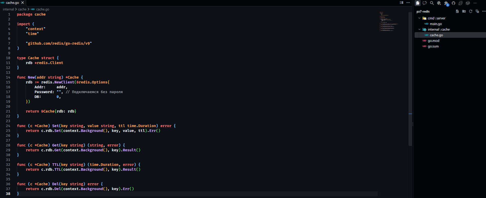

В методе `Set` передаём время жизни ключа через `time.Duration`. Это позволяет задавать TTL непосредственно при сохранении значения, без отдельного вызова `EXPIRE`.
## 4. HTTP-сервер — `cmd/server/main.go`

Реализуем HTTP-сервер на стандартной библиотеке `net/http`. Добавим обработчики для сохранения, получения, проверки TTL и удаления значений.

```go
package main

import (
    "fmt"
    "log"
    "net/http"
    "time"
 
    "example.com/pz7-redis/internal/cache"
)

func main() {
    c := cache.New("localhost:6380")

    mux := http.NewServeMux()

    // Сохранение значения: /set?key=...&value=...
    mux.HandleFunc("/set", func(w http.ResponseWriter, r *http.Request) {
        key := r.URL.Query().Get("key")
        value := r.URL.Query().Get("value")

        if key == "" || value == "" {
            http.Error(w, "key and value required", http.StatusBadRequest)
            return
        }

        // Ключ будет храниться 10 секунд
        err := c.Set(key, value, 10*time.Second)
        if err != nil {
            http.Error(w, err.Error(), http.StatusInternalServerError)
            return
        }

        fmt.Fprintf(w, "OK: %s=%s (TTL 10s)", key, value)
    })

    // Получение значения: /get?key=...
    mux.HandleFunc("/get", func(w http.ResponseWriter, r *http.Request) {
        key := r.URL.Query().Get("key")

        val, err := c.Get(key)
        if err != nil {
            http.Error(w, err.Error(), http.StatusNotFound)
            return
        }

        fmt.Fprintf(w, "VALUE: %s", val)
    })

    // Проверка оставшегося времени: /ttl?key=...
    mux.HandleFunc("/ttl", func(w http.ResponseWriter, r *http.Request) {
        key := r.URL.Query().Get("key")

        ttl, err := c.TTL(key)
        if err != nil {
            http.Error(w, err.Error(), http.StatusInternalServerError)
            return
        }

        fmt.Fprintf(w, "TTL: %s", ttl)
    })

    // Удаление значения: /del?key=...
    mux.HandleFunc("/del", func(w http.ResponseWriter, r *http.Request) {
        key := r.URL.Query().Get("key")

        if err := c.Del(key); err != nil {
            http.Error(w, err.Error(), http.StatusInternalServerError)
            return
        }

        fmt.Fprintf(w, "DELETED: %s", key)
    })

    log.Println("Server started on :8081")
    log.Fatal(http.ListenAndServe(":8081", mux))
}
```

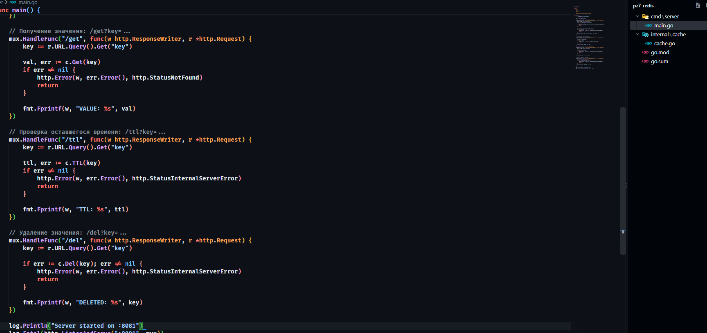
## 5. Запуск сервера

Перейдём в корень проекта и запустим HTTP-сервер:

```
go run ./cmd/server
```

Сервер подключается к Redis по адресу `localhost:6380` и принимает HTTP-запросы на порту `8081`.

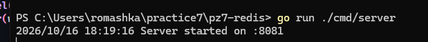
## 6. Проверка API

Для проверки API откроем отдельное окно PowerShell, оставив Go-сервер запущенным.
### 6.1. Сохранение значения с TTL = 10 сек

Отправим запрос на сохранение ключа `test` со значением `hello`:

```powershell
Invoke-WebRequest -Uri "http://localhost:8081/set?key=test&value=hello" -UseBasicParsing | Select-Object -ExpandProperty Content
```

[[СКРИНШОТ: ответ `OK: test=hello (TTL 10s)`]]

### 6.2. Получение значения

Получим сохранённое значение по ключу `test`:

```
Invoke-WebRequest -Uri "http://localhost:8080/get?key=test" -UseBasicParsing |
    Select-Object -ExpandProperty Content
```

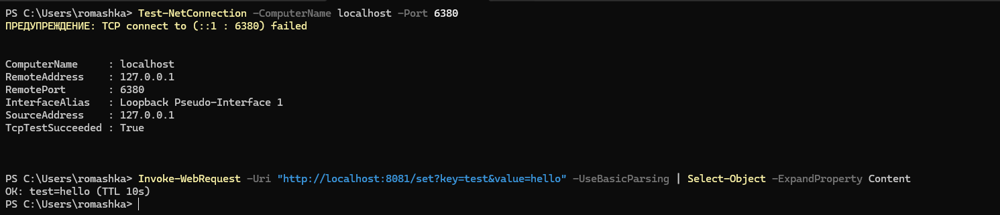

В ответ получили значение `hello`, которое ранее сохранили в Redis.

### 6.3. Проверка TTL

Сразу после сохранения значения проверим оставшееся время его жизни:

```powershell
Invoke-WebRequest -Uri "http://localhost:8081/ttl?key=test" -UseBasicParsing |
    Select-Object -ExpandProperty Content
```

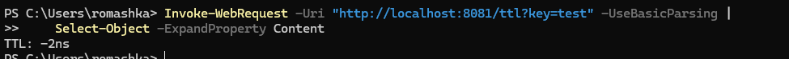

Время зависит от того, сколько прошло с момента выполнения команды `/set`.
### 6.4. Проверка истечения TTL

Подождём 11 секунд, чтобы ключ успел истечь, и повторим запрос на получение значения:

```powershell
Start-Sleep -Seconds 11

Invoke-WebRequest -Uri "http://localhost:8081/get?key=test" -UseBasicParsing
```


После истечения TTL ключ больше не доступен. HTTP-обработчик `/get` возвращает ошибку `404 Not Found`, поскольку Redis не смог получить значение.

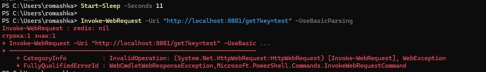
### 6.5. Удаление ключа вручную (опционально)

Проверим удаление ключа до истечения TTL. Сначала сохраним новое значение, а затем удалим его:

```powershell
Invoke-WebRequest -Uri "http://localhost:8081/set?key=foo&value=bar" -UseBasicParsing |
    Select-Object -ExpandProperty Content

Invoke-WebRequest -Uri "http://localhost:8081/del?key=foo" -UseBasicParsing |
    Select-Object -ExpandProperty Content
```

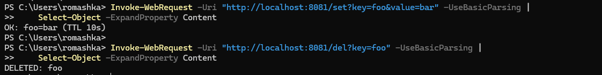
## 7. Публикация в GitHub

Перейдём на ветку практической работы и отправим изменения в удалённый репозиторий:

```
git init
git add .
git commit -m "Практика 7"
git remote add origin https://github.com/...
git branch -M main
git push -u origin main
```

В репозитории сохраняются исходный код HTTP-сервера, реализация кэша и файлы Go-модуля.
## Ответы на контрольные вопросы

**1. Чем Redis отличается от реляционной БД?**

Redis использует модель «ключ–значение» и преимущественно хранит данные в оперативной памяти. Реляционные базы данных, например PostgreSQL и MySQL, организуют данные в таблицы и позволяют выполнять SQL-запросы.

Redis обеспечивает быстрый доступ к данным и подходит для кэширования, но не заменяет полноценную реляционную БД во всех задачах. При этом Redis поддерживает механизмы сохранения данных на диск.

**2. Какие типы данных поддерживает Redis кроме строк?**

Redis поддерживает списки (`list`), множества (`set`), упорядоченные множества (`sorted set` или `zset`), хэши (`hash`), битовые строки (`bitmap`), HyperLogLog, геопространственные индексы (`GEO`) и потоки (`stream`).

**3. Зачем нужен TTL? Приведите примеры.**

TTL ограничивает время хранения ключа. После истечения установленного срока Redis автоматически удаляет его, что позволяет не хранить устаревшие данные и освобождать память.

Например, TTL можно использовать для кэширования списка товаров на 5 минут, автоматического завершения пользовательской сессии через 30 минут или ограничения количества запросов за определённый промежуток времени.

**4. Как Redis помогает снизить нагрузку на PostgreSQL?**

Redis можно использовать как промежуточный кэш между приложением и PostgreSQL. При первом запросе приложение получает данные из основной БД и сохраняет их в Redis. Последующие запросы возвращают результат из кэша, если он ещё существует.

Таким образом, уменьшается количество обращений к PostgreSQL и ускоряется обработка повторяющихся запросов.

Схема работы:

`Клиент → Backend → Redis (есть кэш?) → если нет → PostgreSQL`

**5. Что произойдёт, если ключ в Redis «протух» по TTL, а приложение попытается его прочитать?**

Если ключ истёк, команда `GET` не вернёт его значение. В библиотеке `go-redis` отсутствие ключа представлено ошибкой `redis.Nil`.

В нашей реализации HTTP-обработчик `/get` возвращает `404 Not Found`. В полноценном приложении при отсутствии данных в кэше можно обратиться к основной БД, получить актуальное значение и снова сохранить его в Redis с заданным TTL.